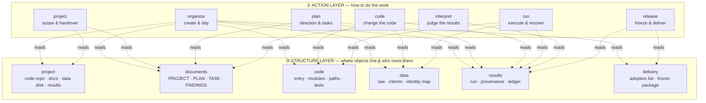

<p align="center">
  
</p>

<h1 align="center">research-project</h1>

<p align="center"><b>A two-layer skill that keeps an AI-driven research project in a fixed, self-describing, checkable shape.</b></p>

<p align="center">
  <a href="README.md">English</a> · <a href="README.zh.md">中文</a> ·
  <a href="#quick-start">Quick start</a> ·
  <a href="#documentation">Docs</a> ·
  <a href="CHANGELOG.md">Changelog</a>
</p>

<p align="center">
  <a href="LICENSE"></a>
  
  
  
</p>

---

**`research-project`** is a self-contained skill for LLM coding agents — Claude Code,
Codex, Pi, or anything that can read a `SKILL.md` and run shell commands.

It does one thing: **make a research project's plans, code, data, results and delivery
material land in predictable places, and make both the agent and you able to check that
they did.**

It is the companion skill to
[ClaimTrace](https://github.com/hasibagen/claimtrace), which handles *what your papers
say*. This one handles *where your project's files live and how they connect*.

## The problem it solves

Every research group eventually hits the same three failures — and an AI agent makes
them worse, not better, because it will cheerfully create `final_v2_fixed/` next to
`final_v2/`:

| Failure | What it looks like in practice |
|---|---|
| **Plan and code drift** | The plan says one threshold; the config says another; the results say a third. Nobody notices for four months. |
| **Nobody can find the data** | "Where is the preprocessing output?" — three answers, three paths, one of them stale. |
| **Results lose their provenance** | A figure exists. Which run made it? Which config? Which input version? The answer is a shrug. |

`research-project` answers all three with structure instead of reminders: a **plan**
that names its resources, a **layout** where each kind of object has one legal home, and
a **run** that records exactly what went in and what came out.

## The idea: two layers

Most "project management" skills fail because they only tell the agent *what to do*.
This one splits the problem in two, so neither half has to be memorised at once:



- **Action layer** — *what you are doing right now.* Load one module per task. Each
  module is a small input → process → output flow with a filled-in example.
- **Structure layer** — *where things belong.* One rule per area, so "should this file
  go in `data/` or `results/`?" has an answer instead of a debate.

**You never load both layers at once.** The action module tells you which structure
modules to pull in, and the skill says so explicitly — so context stays small.

## What's in the box

```text
research-project/
├── SKILL.md                       # entry point: routing table + shared constraints
├── README.md · README.zh.md       # this document (English / 中文)
├── agents/openai.yaml             # host metadata for the skill picker
├── modules/                       # ① ACTION LAYER — one per job
│   ├── organize/  project/  plan/  code/  run/  interpret/  release/
│   │   └── each: GUIDE.md + EXAMPLE.md
│   └── plan/                      # plan module ships its own protocol + checker
│       ├── assets/                #   PLAN.md · TASK.md · handoff.md
│       ├── references/            #   protocol · sources · exploration · review
│       ├── scripts/check_plans.py #   read-only plan/dependency/evidence audit
│       └── tests/                 #   15 tests for the plan checker
├── structures/                    # ② STRUCTURE LAYER — one per object area
│   ├── project/                   #   scope · placement-rules · entrypoints
│   ├── documents/  code/  data/  results/  delivery/
│   └── each: GUIDE.md + EXAMPLE.md
├── assets/
│   ├── templates/                 # 21 copy-ready files (19 Markdown + 2 JSON Schema)
│   │   └── project-scaffold/      #   AGENTS.md · README.md · docs-readme.md · gitignore
│   └── demo/                      #   end-to-end synthetic demo + fault drill
├── references/                    # shared contracts & mechanism provenance
├── scripts/                       # record adapter · scaffold generator · 5 MB gate
├── tests/                         # 26 tests for the templates and contracts
└── docs/                          # the rules, the workflows, the design record
```

| Layer | Module | Use it when you are… |
|---|---|---|
| ① Action | `organize` | creating a project, or folding an old layout into a new one |
| ① Action | `project` | setting scope, sharing dependencies, handing over, wrapping up |
| ① Action | `plan` | choosing a direction, splitting a plan into tasks, tracking progress |
| ① Action | `code` | changing research code or config, and checking what it affects |
| ① Action | `run` | executing, resuming, or importing results from a job |
| ① Action | `interpret` | comparing runs, forming a judgement, scheduling what follows |
| ① Action | `release` | freezing a method, packaging a study, archiving |
| ② Structure | `project` | the relation between code repo, docs, data disk and results root |
| ② Structure | `documents` | PROJECT / PLAN / TASK / FINDINGS / LOG — the paper trail |
| ② Structure | `code` | entry points, compute modules, path resolution, environment, tests |
| ② Structure | `data` | single- vs multi-modal, `raw` vs `interim`, identity mapping |
| ② Structure | `results` | the results root, `runs/<run_id>`, provenance, ledger, archiving |
| ② Structure | `delivery` | the adoption list, manuscript sources, the frozen package |

## The layout it enforces

The skill does not invent a layout for you — it gives every kind of object **one** legal
home, and a rule for what may move where.

```text
<code repo>/                       # code, documents and configuration
├── AGENTS.md                      # current architecture, constraints, area entry points
├── README.md                      # purpose, overall tree, minimal usage example
├── .gitignore
├── docs/
│   ├── README.md                  #   doc tree and read/write examples
│   ├── PROJECT.md                 #   authoritative resource map, plan entry points
│   └── plans/<plan_id>/           #   PLAN, TASK, LOG; FINDINGS & DELIVERY as needed
├── code/
│   ├── README.md                  #   dependency direction, execution and checks
│   ├── run_analysis.py            #   example entry point
│   ├── preprocessing/ · statistics/ · ml/
│   ├── tests/fixtures/            #   small synthetic inputs + known expectations
│   ├── notebooks/                 #   exploration only
│   └── utils/path_manager.py      #   the one place that resolves absolute paths
├── configs/                       # science config and machine config, kept apart
└── environment.yml

<data disk project root>/          # may live on another disk; PROJECT.md maps it
├── README.md                      # actual paths, data origins, results entry
├── naming/                        # controlled name ↔ research-ID mapping
├── data/<modality>/{raw,interim}  # raw is READ-ONLY
└── results/                       # the results root
    ├── README.md                  #   results + input architecture, how to locate things
    ├── registry.json              #   explicit ledger of completed runs
    └── runs/<run_id>/
        ├── record.json             #   what ran, with what inputs
        ├── config_used.yaml        #   the effective config snapshot
        ├── provenance/             #   input identity, upstream artifacts, code + env
        ├── tmp/ · logs/ · tables/ · figures/
        ├── predictions/ · labels/ · model_dump/ · artifacts/
        └── CHECKS.md               #   check results, with evidence
```

Three things worth calling out:

- **`raw` is read-only.** Raw data is never edited; corrections go to `interim` with a
  new version. This one rule removes an entire class of silent data corruption.
- **A new run, not an edited run.** Change an input, the science config, or the code →
  that is a new `run_id` with a new `record.json`. Existing runs stay comparable forever.
- **The PLAN names its resources.** Every plan has a *"本计划资源与目录"* section listing
  the data, code, results and references it actually uses — with full absolute paths,
  read/write boundaries, and a verification status. You stop asking "where is that file?"
  in a chat transcript.

## Quick start

**Requirements:** the skill itself is Markdown, so any agent that reads files can use
it. The helper scripts need Python ≥ 3.10. The **demo** additionally needs `snakemake`,
`rocrate-validator`, `rocrate` and `jsonschema`, and the `snakemake` /
`rocrate-validator` executables must sit **next to the interpreter you run it with**
(the demo resolves them from `sys.executable`):

```bash
python3 -m pip install snakemake rocrate roc-validator jsonschema
```

If those are installed in a conda environment, run the demo with that environment's
Python — the demo's own README states the same requirement.

```bash
# 1. Get the skill where your agent looks for skills
git clone https://github.com/hasibagen/research-project.git
cp -r research-project ~/.claude/skills/     # Claude Code
# cp -r research-project ~/.codex/skills/    # Codex
# cp -r research-project ~/.pi/skills/       # Pi

# 2. Point your agent at it
#    Claude Code :  /research-project <your task>
#    Codex / Pi  :  "使用 $research-project，<your task>"

# 3. Let the agent work out where things go
#    "Set up a new project called <name>. Data lives on the data disk at <path>."
```

The agent reads `SKILL.md`, picks the action module that matches the job, pulls in only
the structure modules that job needs, and writes the plan before it writes the code.

### Try the demo first (no real data)

```bash
cd skills/research-project/assets/demo
python run_demo.py --output /tmp/rp-demo-$(date +%s)
```

It runs a real Snakemake pipeline over synthetic data, emits provenance records and
imports them de-duplicated, exports an RO-Crate, validates the crate with
`roc-validator`, and finally back-fills the question page with the run's findings.
Then read the logs it leaves behind — they are the shape of a real run.

There is also a fault drill:

```bash
python fault_demo.py --output /tmp/rp-fault-$(date +%s)
```

It kills a real subprocess mid-import and then recovers, to show that a re-import does
not duplicate facts and that a same-`run_id` conflict is refused rather than merged.

## The rules that carry the weight

Everything else in the skill is detail. These seven are the load-bearing ones:

1. **Raw data is read-only.** Corrections land in `interim/<dataset_id>/<version>`.
2. **One fact, one home.** The same fact is never written twice; shared artifacts are
   *referenced*, never copied and forked.
3. **A new input, config or code change means a new run.** Old runs stay intact.
4. **Never delete because the name looks old.** Map the old layout first; only clean up
   inside the scope you were actually authorised for.
5. **"Unchecked" is not "passed".** Template generated, program ran, science is valid,
   and formally adopted are four different reports — and the skill says so out loud.
6. **Existing projects are read-only by default.** Report the gap; do not migrate
   someone's repo because the layout looks nicer.
7. **Read before you write, and check the baseline before you land.** Change one writer
   at a time.

## What it checks for you

| Command | Checks |
|---|---|
| `python scripts/check_repo_files.py --root <repo>` | 5 MB file gate for Git and colocated-jj candidates, and Git index blobs |
| `python modules/plan/scripts/check_plans.py --root <repo> --plans <dir>` | plan identity, dependency and evidence checks (read-only; it does not validate science) |
| `python scripts/create_project_template.py --output <dir> --project <name> --plan <id> --task <id>` | scaffold a self-contained project + run template |
| `python scripts/research_records.py` | small local record adapter for run records and provenance |
| `python -m pytest tests/ modules/plan/tests/` | the template and contract test suite (41 tests) |

## Documentation

| Document | What it covers |
|---|---|
| [`SKILL.md`](SKILL.md) | the entry point: routing table, shared constraints, how to start reading |
| [`docs/system-architecture.md`](docs/system-architecture.md) | how the two layers fit together, and why |
| [`docs/two-layer-design.md`](docs/two-layer-design.md) | the design record behind the two-layer split |
| [`docs/architecture-contract.md`](docs/architecture-contract.md) | cross-module read/write rules and recovery |
| [`docs/daily-operations.md`](docs/daily-operations.md) | start-of-day, execution and delivery: four entry points, backups, final-review gate |
| [`docs/results-workflow.md`](docs/results-workflow.md) | analysis design and how results are written back |
| [`docs/snakemake-workflow.md`](docs/snakemake-workflow.md) | multi-step execution and recovery |
| [`docs/research-principles.md`](docs/research-principles.md) | research stages, reproducibility, evidence scope |
| [`docs/template-guide.md`](docs/template-guide.md) | generating new projects and running the existing validators |
| [`docs/skill-interoperability.md`](docs/skill-interoperability.md) | sharing plans with other skill packs |
| [`docs/design-plan.md`](docs/design-plan.md) | the full design record (contains a synthetic worked example) |

Every `GUIDE.md` under `modules/` and `structures/` ships with a matching `EXAMPLE.md`
showing the same thing filled in — so you can copy the shape instead of inventing it.

## Honest scoping — when *not* to use this

- **You want a project-management app.** This is a skill: it is a set of rules an agent
  follows, plus templates and checkers. There is no UI, no database, no scheduler.
- **Your project is a single script.** One file with one result does not need a plan
  layer. Over-structure is a real cost.
- **You need multi-user workflow with permissions.** This is local-first and
  git-versioned; coordination happens in git, not in a service.
- **You expect it to do the science.** The skill enforces *structure and provenance*.
  Whether a result is scientifically valid is still your call, and the checkers
  explicitly refuse to claim otherwise.

## Provenance of this release

This is a **public, de-identified release**. Every project name, plan name, config and
script name, absolute path, session id and run identifier has been replaced with a
synthetic placeholder; the numbers, counts and metrics in the worked examples are
illustrative, not measurements. The local archives, snapshots and validation logs that
the private copy points at are not included. The rules, the templates, the scripts and
the tests are complete and unmodified in substance.

See [`docs/README.md`](docs/README.md) for the note on what was removed and where the
current rules now live.

## Citation

```bibtex
@software{researchproject2026,
  author = {hasibagen},
  title  = {research-project: A two-layer skill for AI-driven research project management},
  year   = {2026},
  url    = {https://github.com/hasibagen/research-project}
}
```

## License

[MIT](LICENSE) — the skill, its modules, templates, scripts and tests.
Your own project content stays yours.
