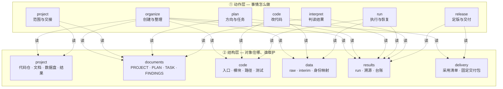

<p align="center">
  
</p>

<h1 align="center">research-project</h1>

<p align="center"><b>一个双层 skill：让 AI 参与的科研项目始终待在固定、自解释、可检查的位置上。</b></p>

<p align="center">
  <a href="README.md">English</a> · <a href="README.zh.md">中文</a> ·
  <a href="#快速开始">快速开始</a> ·
  <a href="#文档">文档</a> ·
  <a href="CHANGELOG.md">更新日志</a>
</p>

<p align="center">
  <a href="LICENSE"></a>
  
  
  
</p>

---

**`research-project`** 是一个自包含的 skill，供 LLM 编程助手使用 —— Claude Code、
Codex、Pi，或者任何能读 `SKILL.md`、能执行 shell 命令的助手。

它只做一件事：**让科研项目的计划、代码、数据、结果和交付材料落在可预测的位置，
并且让你和助手都能检查出「确实落在那里」。**

它是
[ClaimTrace](https://github.com/hasibagen/claimtrace) 的配套 skill：那个负责
*你的论文说了什么*，这个负责 *你项目里的文件住在哪、彼此怎么连起来*。

## 它解决什么问题

每个科研团队最后都会撞上同样三个坑 —— 而 AI 助手不是让它们变少，而是让它们
**更多**，因为助手会很乐意在 `final_v2/` 旁边再建一个 `final_v2_fixed/`：

| 坑 | 实际长什么样 |
|---|---|
| **计划与代码脱节** | 计划里写着一个阈值，配置里是另一个，结果里是第三个。四个多月没人发现。 |
| **谁也找不到数据** | 「预处理结果在哪？」—— 三个答案、三条路径，其中一条已经过期。 |
| **结果丢了出处** | 图还在。可它是哪次 run 生成的？哪份配置？哪一版输入？没人知道。 |

`research-project` 用**结构**而不是**提醒**来回答这三个问题：一份点明自己资源的
**计划**，一个让每类对象只有一个合法住所的**布局**，以及一次记录清楚「输入是什么、
产出是什么」的**运行**。

## 核心想法：两层

多数「项目管理」skill 之所以不好用，是因为它们只告诉助手*该做什么*。这个 skill
把问题拆成两层，于是任何一层都不需要被一次性记住：



- **动作层** —— *你现在正在做什么*。一个任务只加载一个模块。每个模块都是一条小的
  「输入 → 处理 → 输出」流程，并配一份填好的样例。
- **结构层** —— *东西该放哪*。每个区一条规则，于是「这个文件该进 `data/` 还是
  `results/`」有了答案，而不是一场讨论。

**两层永远不同时全量加载。** 动作模块会写明该拉哪些结构模块进来，skill 里也明说了
这一点 —— 所以上下文一直很小。

## 里面有什么

```text
research-project/
├── SKILL.md                       # 入口：路由表 + 共同约束
├── README.md · README.zh.md       # 本文件（English / 中文）
├── agents/openai.yaml             # 供宿主选择 skill 用的元信息
├── modules/                       # ① 动作层 —— 一个模块一件事
│   ├── organize/  project/  plan/  code/  run/  interpret/  release/
│   │   └── 每个模块各一份 GUIDE.md + EXAMPLE.md
│   └── plan/                      # plan 模块自带协议和检查器
│       ├── assets/                #   PLAN.md · TASK.md · handoff.md
│       ├── references/            #   协议 · 来源 · 探索 · 复核
│       ├── scripts/check_plans.py #   只读的计划／依赖／证据审计
│       └── tests/                 #   计划检查器的 15 项测试
├── structures/                    # ② 结构层 —— 一个模块一类对象
│   ├── project/                   #   范围 · 归属规则 · 入口
│   ├── documents/  code/  data/  results/  delivery/
│   └── 每个区各一份 GUIDE.md + EXAMPLE.md
├── assets/
│   ├── templates/                 # 21 个可直接复制的文件（19 个 Markdown + 2 份 JSON Schema）
│   │   └── project-scaffold/      #   AGENTS.md · README.md · docs-readme.md · gitignore
│   └── demo/                      #   端到端合成演示 + 故障演练
├── references/                    # 共同契约与机制出处
├── scripts/                       # 记录适配器 · 脚手架生成器 · 5 MB 闸门
├── tests/                         # 模板与契约的 26 项 pytest 测试
└── docs/                          # 规则、工作流、设计记录
```

| 层 | 模块 | 什么时候用 |
|---|---|---|
| ① 动作 | `organize` | 新建项目，或把旧布局收拢成新布局 |
| ① 动作 | `project` | 定范围、共享依赖、开工、交接、收尾 |
| ① 动作 | `plan` | 定方向、拆计划与任务、跟进进度 |
| ① 动作 | `code` | 改科研代码或配置，并核对影响面 |
| ① 动作 | `run` | 执行、恢复，或把作业结果导进来 |
| ① 动作 | `interpret` | 比较 run、形成判断、安排后续 |
| ① 动作 | `release` | 固定方法、打包研究、归档 |
| ② 结构 | `project` | 代码仓、文档、数据盘、结果根之间的关系 |
| ② 结构 | `documents` | PROJECT / PLAN / TASK / FINDINGS / LOG 这条证据链 |
| ② 结构 | `code` | 入口、计算模块、路径解析、环境、测试 |
| ② 结构 | `data` | 单模态／多模态、raw／interim、身份映射 |
| ② 结构 | `results` | 结果根、`runs/<run_id>`、溯源、台账、归档 |
| ② 结构 | `delivery` | 采用清单、稿件来源、固定交付包 |

## 它强制的布局

这个 skill 不会替你凭空发明一套布局 —— 它只是给每类对象**一个**合法住所，以及一条
「什么可以挪到哪里」的规则。

```text
<code repo>/                       # 代码、文档与配置
├── AGENTS.md                      # 当前架构、操作约束、各区入口
├── README.md                      # 目的、整体树、最小使用样例
├── .gitignore
├── docs/
│   ├── README.md                  #   文档树与读写样例
│   ├── PROJECT.md                 #   权威资源映射、计划入口
│   └── plans/<plan_id>/           #   PLAN、TASK、LOG；FINDINGS 与 DELIVERY 按需
├── code/
│   ├── README.md                  #   依赖方向、执行与检查样例
│   ├── run_analysis.py            #   示例入口
│   ├── preprocessing/ · statistics/ · ml/
│   ├── tests/fixtures/            #   小型合成输入与已知期望
│   ├── notebooks/                 #   探索时按需
│   └── utils/path_manager.py      #   解析绝对路径的唯一入口
├── configs/                       # 科学配置与机器配置分开
└── environment.yml

<数据盘项目根>/                    # 可以另起一块盘，由 PROJECT.md 登记映射
├── README.md                      # 真实路径、数据来源、结果入口
├── naming/                        # 姓名 ↔ 研究 ID 的受控映射
├── data/<模态>/{raw,interim}      # raw 只读
└── results/                       # 结果根
    ├── README.md                  #   结果与输入数据架构、定位样例
    ├── registry.json              #   完成记录的显式登记
    └── runs/<run_id>/
        ├── record.json             #   跑了什么、用了什么输入
        ├── config_used.yaml        #   实际生效的配置快照
        ├── provenance/             #   输入身份、上游产物、代码与环境
        ├── tmp/ · logs/ · tables/ · figures/
        ├── predictions/ · labels/ · model_dump/ · artifacts/
        └── CHECKS.md               #   检查结果及其证据
```

有三点特别值得说：

- **`raw` 只读。** 原始数据永不修改；要修正就写到 `interim/<dataset_id>/<version>`。
  这一条规则就消灭了一整类静默的数据损坏。
- **改了就新开一个 run，而不是改旧的。** 换了输入、科学配置或代码 —— 那就是一个新的
  `run_id` 和新的 `record.json`。老 run 永远保持可比。
- **PLAN 自己点名自己的资源。** 每份计划都有一节「本计划资源与目录」，列出它真正
  用到的数据、代码、结果和参考资料，含完整绝对路径、读写边界与核对状态。你不用再
  去翻聊天记录问「那个文件在哪」。

## 快速开始

**环境要求：** skill 本身是 Markdown，任何能读文件的助手都能用；辅助脚本需要
Python ≥ 3.10。**演示**还需要 `snakemake`、`rocrate-validator`、`rocrate` 与
`jsonschema`，并且 `snakemake` 与 `rocrate-validator` 可执行文件必须与运行它的解释器
**放在一起**（演示从 `sys.executable` 旁边找它们）：

```bash
python3 -m pip install snakemake rocrate roc-validator jsonschema
```

如果这些装在 conda 环境里，就用那个环境的 Python 跑演示 —— 演示自带的 README 也
写了同样的要求。

```bash
# 1. 把 skill 放到你的助手会找的位置
git clone https://github.com/hasibagen/research-project.git
cp -r research-project ~/.claude/skills/     # Claude Code
# cp -r research-project ~/.codex/skills/    # Codex
# cp -r research-project ~/.pi/skills/       # Pi

# 2. 让助手用它
#    Claude Code :  /research-project <你的任务>
#    Codex / Pi  :  "使用 $research-project，<你的任务>"

# 3. 让助手自己判断东西该放哪
#    "新建一个叫 <名字> 的项目。数据在数据盘 <路径>。"
```

助手会读 `SKILL.md`，挑出与任务匹配的动作模块，只拉它需要的那几个结构模块，
**先写计划，再写代码**。

### 先跑演示（不碰真实数据）

```bash
cd skills/research-project/assets/demo
python run_demo.py --output /tmp/rp-demo-$(date +%s)
```

它会用合成数据跑一遍真实的 Snakemake 流程，产出溯源记录并去重导入，导出 RO-Crate，
用 `roc-validator` 校验，最后把本次运行的发现回填到问题页。然后读它留下的日志 ——
那就是一次真实 run 的样子。

还有一个故障演练：

```bash
python fault_demo.py --output /tmp/rp-fault-$(date +%s)
```

它在导入中途杀掉真实子进程再恢复，用来演示：重复导入不会制造重复事实；同一个
`run_id` 出现不同内容会被拒绝，而不是被悄悄合并。

## 真正吃重的七条规则

其余都是细节，这七条才是承重的：

1. **原始数据只读。** 修正落到 `interim/<dataset_id>/<version>`。
2. **一个事实一个家。** 同一事实绝不写两遍；共享产物靠**引用**，不靠复制和分叉。
3. **输入、配置或代码一变，就是一个新 run。** 老 run 原样保留。
4. **不要因为名字看着旧就删。** 先映射旧布局；清理只限在你被明确授权的范围内。
5. **「没核对」不等于「通过」。** 模板生成、程序跑通、科学有效、正式采用 —— 这是
   四件要分开报告的事，skill 会明确说出来。
6. **已有项目默认只读。** 报告缺口；不要因为别人的布局不好看就擅自迁移。
7. **写前重读，落盘前核对基线。** 同一时间只让一个工具改这份文件。

## 它能替你检查什么

| 命令 | 检查什么 |
|---|---|
| `python scripts/check_repo_files.py --root <repo>` | Git 与同仓 jj 候选项的 5 MB 文件闸门，以及 Git index 中的 blob |
| `python modules/plan/scripts/check_plans.py --root <repo> --plans <dir>` | 计划身份、依赖与证据检查（只读；**不**判断科学有效性） |
| `python scripts/create_project_template.py --output <dir> --project <名> --plan <id> --task <id>` | 生成自包含的项目 + run 脚手架 |
| `python scripts/research_records.py` | 本地 run 记录与溯源的小型适配器 |
| `python -m pytest tests/ modules/plan/tests/` | 模板与契约的测试套件（41 项） |

## 文档

| 文档 | 讲什么 |
|---|---|
| [`SKILL.md`](SKILL.md) | 入口：路由表、共同约束、从哪儿开始读 |
| [`docs/system-architecture.md`](docs/system-architecture.md) | 两层如何配合，以及为什么这么设计 |
| [`docs/two-layer-design.md`](docs/two-layer-design.md) | 双层拆分背后的设计记录 |
| [`docs/architecture-contract.md`](docs/architecture-contract.md) | 跨模块读写规则与恢复约定 |
| [`docs/daily-operations.md`](docs/daily-operations.md) | 开工、执行与交付：四个入口、备份、终评准入 |
| [`docs/results-workflow.md`](docs/results-workflow.md) | 分析设计与结果回填 |
| [`docs/snakemake-workflow.md`](docs/snakemake-workflow.md) | 多步骤执行与恢复 |
| [`docs/research-principles.md`](docs/research-principles.md) | 研究阶段、复现、证据范围 |
| [`docs/template-guide.md`](docs/template-guide.md) | 新项目生成与现有校验器的用法 |
| [`docs/skill-interoperability.md`](docs/skill-interoperability.md) | 与其他流程包共用计划 |
| [`docs/design-plan.md`](docs/design-plan.md) | 完整设计记录（含一份合成实例） |

`modules/` 和 `structures/` 下每个 `GUIDE.md` 都配一份同名的 `EXAMPLE.md`，
把同样的东西填满 —— 你照着复制形状就行，不用自己发明。

## 老实说：什么时候**别**用它

- **你想要一个项目管理 App。** 这是 skill：一套助手会遵守的规则，加模板和检查器。
  没有界面、没有数据库、没有调度器。
- **你的项目只有一个脚本。** 一个文件、一个结果，不需要计划层。过度结构本身有成本。
- **你需要带权限的多人协作。** 这是本地优先、git 版本化的；协作发生在 git 里，
  不在某个服务里。
- **你指望它替你做科学判断。** 这个 skill 保证的是**结构与溯源**。结果在科学上
  是否成立仍然由你决定，检查器也明确拒绝替你宣称。

## 这个公开版的出处

这是一个**已脱敏的公开版**。所有项目名、计划名、配置与脚本名、绝对路径、session id
和 run 标识都换成了合成占位符；示例中的数值、计数与指标都是示意值，不是真实测量。
私有版本指向的本地归档、快照和验证日志都没有包含进来。规则、模板、脚本和测试在
实质上是完整且未改动的。

关于移除了什么、现行规则现在住哪，见 [`docs/README.md`](docs/README.md)。

## 引用

```bibtex
@software{researchproject2026,
  author = {hasibagen},
  title  = {research-project: A two-layer skill for AI-driven research project management},
  year   = {2026},
  url    = {https://github.com/hasibagen/research-project}
}
```

## 许可证

[MIT](LICENSE) —— skill、模块、模板、脚本与测试。
你自己项目的内容仍然归你。
