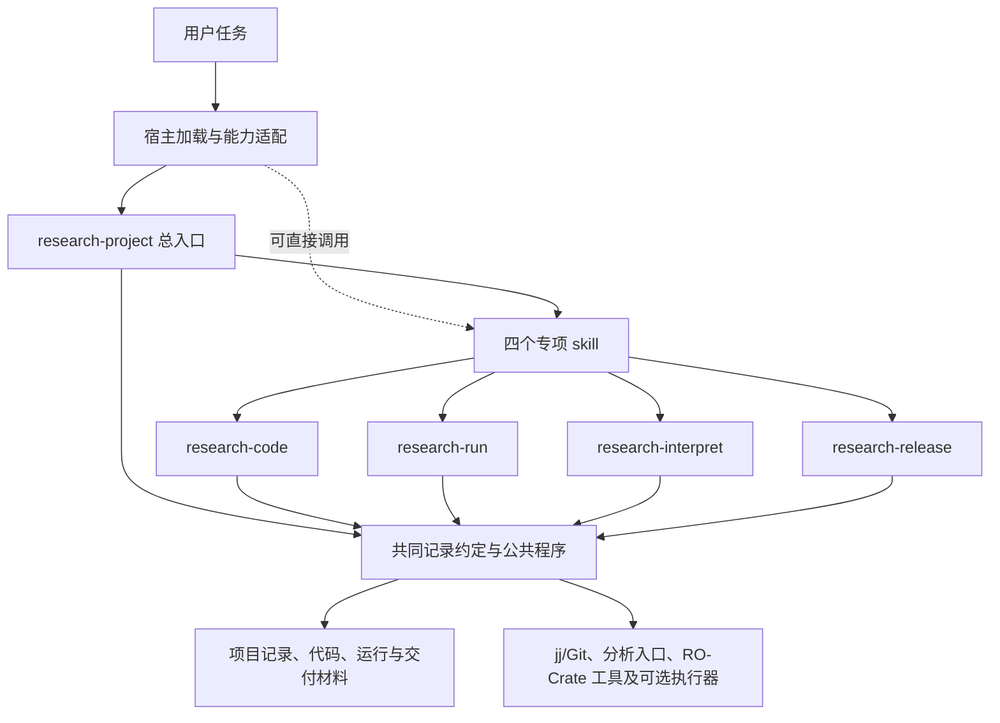

> 文档集角色：设计与实施规划。历史完成状态以 [实施记录](implementation-report.md) 为准。

> 本文件是产品设计书；日常执行以 [日常操作规范](daily-operations.md) 为入口。设计中的未来能力不作为今天开展研究的前置条件。

# 研究项目管理 Skill Plan：从可重复研究实践到跨 AI 协作

> 2026-10-19 实施进展：总 skill 的本地首版已创建（2026-10-21 重构为一个总入口 + 七个动作模块 + 六个结构模块；本文 §10.4、§13 的五／六 skill 说法为历史沿革，已被双层重构取代），合成 Python 的 Snakemake → 来源记录 → RO-Crate 基础校验 → 问题页回填已实测。完整发布验收仍未完成，具体范围见[首版验证记录](implementation-report.md)。

> 修订日期：2026-10-19。本文是待实现的设计方案，不表示 skill、公共程序或宿主适配已经可用。
> 当前主线：代码管理和项目管理；实践依据是 The Turing Way；首个分析 demo 同时接入 Snakemake 与 RO-Crate；面向其他编码助手宿主、其他执行环境、pi、Codex、Claude Code 等宿主，计划开源。
> 本文替换当前 v12 的组织方式。此前的具体项目案例、现场数字和方案演变保存在[本次修订前稿](historical-v12.md)。它们只作设计史依据，不进入示例。

## 1. 为什么要做这个 skill

研究项目会持续变化：代码改了，数据补了，方法换了，计算在另一台机器上运行，解释结果的 AI 也换了。困难往往不在某一次计算，而在几周之后还能否说清楚：为什么做、做到了哪里、结果来自哪里、下一步是什么。

本 skill 要让一个研究者与不同 AI 共用一套可接续的工作方式。任何接手者都能从项目本身找到当前目标、代码版本、运行事实、研究判断和后续行动；接入第二个项目时，复用同一套管理程序。

一次完整工作可以是：接手项目 → 明确任务 → 改代码并检查 → 运行分析 → 验收和解释结果 → 更新安排 → 交接或发布。研究过程允许往返；每次实际执行留下可核对的记录。

### 使用者和成功标准

主要使用者是有代码、数据和长期研究任务的个人或小团队。支持 Python、R、MATLAB 混合项目，也支持暂时只有文档和简单脚本的项目。管理力度随任务需要增加。

成功应表现为：

- 换 AI、换机器或中断后，能从仓内记录继续，不必重讲全部历史。
- 看见一个结果，能找到实际代码、配置、输入和检查依据，或明确指出缺口。
- 修改代码后，能知道哪些产物受到影响；正式历史结果不被新运行覆盖。
- 新项目主要增加科学内容，不重新实现编号、记录、回传和状态系统。
- 管理减少重复解释、手工抄数和恢复时间；新增记录成本能够测量。

它不替代领域分析工具，也不自动裁决科学结论。初版不建设中心服务器、通用项目看板或新的实验数据库。

## 2. 方法、skill、标准和工具分别负责什么

| 名称 | 性质 | 在本方案中的职责 | 使用者如何接触 |
|---|---|---|---|
| The Turing Way | 研究实践手册及协作社区 | 提供项目设计、版本控制、文档、复用与协作的依据 | 开发和维护 skill 时参考；研究者不必每天重读 |
| 本项目管理 skill | AI 的操作约定 | 识别当前场景，决定读什么、做什么、留下什么及如何验收 | 用户提出任务，AI 按相关流程执行 |
| 项目配置与项目记录 | 具体项目的事实和约定 | 保存目标、权限、路径映射、代码与运行状态、判断及行动 | 任何宿主读取同一份记录 |
| RO-Crate | 研究材料的描述与交换标准 | 把代码、输入、配置、结果和说明组织为可理解的研究包 | 公共导出器生成，校验器检查 |
| jj/Git、Snakemake 等 | 执行工具 | 分别完成版本管理、计算编排等具体动作 | 由场景和项目能力决定是否调用 |

The Turing Way 不规定本 skill 的文件名、状态枚举或 AI 调用协议。这些属于本方案的设计选择。RO-Crate 也不会自动保存代码历史、同步任务清单或判断研究方向。

RO-Crate 的使用口径统一如下：执行时持续保存源记录；正式比较收尾时可生成运行包；阶段冻结、采用或交付时生成经过检查的固定快照。临时探索不必每次都导出，但不能丢掉将来需要的实际输入和执行信息。

## 3. 从 The Turing Way 转成可执行原则

以下是对相关实践的具体应用，不声称是官方认证的方法论。

| 实践原则 | skill 中的具体规则 | 保护什么 |
|---|---|---|
| 从项目目的、使用者与资源开始设计 | 接入先确认研究问题、交付目标、当前入口和约束，再安排目录与工具 | 避免先整理文件、后发现没解决问题 |
| 可重复性从工作开始积累 | 执行前确定代码、输入、有效配置和环境，执行后检查产物 | 避免最后凭记忆补材料 |
| 透明包含行动及决定理由 | 结果引用证据；改变安排说明原因、范围和确认依据 | 让接手者理解为什么这样做 |
| 研究包包含方法、数据、环境和说明 | 同时保存材料及联系；外部数据保留身份和访问条件 | 让结果脱离原会话仍能解释 |
| 软件复用需要接口、测试和版本 | 公共程序只维护一份，项目固定版本；接口变化有迁移说明 | 防止每个项目复制后各自漂移 |
| 协作需要明确分工与贡献路径 | 共享文件约定写入者、冲突处理和审阅方式 | 防止不同 AI 相互覆盖 |
| 实践应服务人并降低参与门槛 | 保留既有入口；按场景加载说明；允许 Git 或 jj，允许不同宿主 | 避免把个人环境当成公共前提 |
| 开放与受限访问可以并存 | 公开通用代码、流程和合成示例；受控研究材料按项目政策处理 | 支持复用而不混同代码公开与数据公开 |

另保留三条来自实际研究需求的约束：程序成功、检查通过、研究采用分别记录；结论写清适用范围；新判断可以取代旧判断，但保留旧依据及改变理由。

## 4. 一套 skill 如何在不同 AI 中使用

### 4.1 通用规则、宿主适配、项目配置

通用规则规定动作含义与记录要求；宿主适配把动作映射为实际文件、终端和用户交互能力；项目配置说明本项目的入口、路径、权限和所用工具版本。三者独立维护，避免为每种模型复制一套管理方法。

模型与宿主分别记录。例如同一模型可能通过不同客户端执行任务；兼容性取决于客户端提供的读写、命令执行、确认和中断机制，不能只凭模型名称宣称支持。

| 部分 | 应放内容 | 不应放内容 |
|---|---|---|
| 通用 SKILL.md | 触发范围、核心约束、场景路由、输出要求 | 个人绝对路径、某宿主专用 API、整套参考书 |
| 场景参考文件 | 运行、判读、交接、发布等详细流程 | 多处重复的字段定义 |
| 宿主适配说明 | 如何加载入口、映射工具、处理权限、返回执行结果 | 另一套研究判断规则 |
| 项目配置 | 记录位置、数据映射、领域检查、版本和授权边界 | 重复维护公共程序源码 |
| 公共程序 | 校验、生成元数据、去重、冲突检测、视图生成 | 替用户决定研究意义 |

### 4.2 能力检查与降级

接入只检查当前任务实际需要的能力。只读宿主可以解释现状和生成待应用补丁；能写文件但不能执行命令时，可以更新已授权记录，却必须把运行验证标为未执行。没有后台能力时，记录已有作业号与核对时间，交给下一次会话继续。

自动 hook、持久记忆、联网和 MCP 都是可选增强。流程完成与否以项目记录和工具回执为依据。宿主记忆只帮助检索，不成为唯一事实来源。

其他编码助手宿主、其他执行环境、pi、Codex、Claude Code 均列为目标适配对象；当前状态统一为待实测。发布兼容表须注明宿主版本、模型、操作系统、能力限制、测试日期和通过场景。

## 5. 共享记录：写一次，其他地方引用

先定义职责，再映射到已有文件。下列名称是建议默认值；老项目可以保留既有名称。初版不强制批量改目录。

| 信息 | 建议载体 | 写入规则 |
|---|---|---|
| 项目入口与运行约定 | AGENTS.md 或宿主可达的统一入口 | 说明目的、常用命令、记录位置；宿主桥接只引用它 |
| 当前目标与行动 | PLAN.md | 人工目标与生成视图有明确边界；行动有来源、状态和完成标准 |
| 判断与改变理由 | LOG.md | 追加记录，带证据、范围、确认依据和被取代关系 |
| 一次运行的事实 | 既有 manifest/运行记录与原始产物 | 记录实际执行内容；结束后保持历史快照 |
| 跨运行目录 | 可重建的运行索引 | 从源记录生成，不手抄另一套数字 |
| 交付采用关系 | 交付清单或既有 paper 映射 | 指明哪项交付引用哪份结果和判断 |
| 机器可交换的研究包说明 | ro-crate-metadata.json | 从上述材料生成，固定所用标准与 profile |

一个事实只有一个权威来源。例如判断全文只在 LOG；当前页引用判断，不复制后各改各的。运行是否成功来自回执；某结果是否采用来自确认记录。

### 必要字段与状态

运行记录至少能说明：运行身份、关联任务或问题、实际代码、入口、有效配置、确切输入、环境、起止时间、执行状态、输出与检查结果。领域字段按需增加，不能要求每个任务都有 p 值、GPU 或模型。

任务状态、运行状态、证据检查和研究处置分开：

- 任务：待办、进行中、受阻、待检查、完成、暂缓或取消。完成必须满足本任务验收条件。
- 运行：排队、运行、成功、失败、中断；远端未核对时另标状态新鲜度。
- 检查：未检查、通过、部分通过、不通过；附检查范围和来源缺口。
- 研究：待解释、待复核、已形成判断；“采用或停止”另附决定及确认依据。

工程失败不能转成科学负结果。检查通过也只覆盖实际检查内容，不等于结论可靠或可推广。

判断采用六项语义：问题、观察及证据、解释与范围、决定及确认依据、后续行动、重开或复核条件。可以用简短 Markdown 表达，固定枚举不能代替解释。已有授权或预先确认的规则可直接执行并记录依据；新的研究取舍才提交用户决定。

### 多主线与组合方案的共同约定

项目允许多个主线 plan，总览引用它们。主线下按研究问题组织比较；分析方案由数据、任务或目标、清洗、预处理、特征、模型和评估等组件组成；实际执行形成 run，run 内可以有多条结果。方案名称与配置引用沿用已有机制，不另建强制的多层 ID。

方法变体、实现版本、参数配置、数据快照、执行次数分别记录。确定方案须展开默认值和覆盖项，固定实际输入与代码；结果引用定位到具体行或产物。展示时先按可比条件分组，再解释指标。数据产品之间记录依赖，支持有效复用和变更影响检查。具体如何应用见第 9.1—9.6 节的示例项目实例。

## 6. AI 在什么时候做什么

每个场景都遵守“触发 → 读取 → 动作 → 输出 → 验收 → 异常处理”。只进入本次任务需要的场景。读一段文档不触发全项目存档；修一个注释不要求生成研究包。

### A. 接入或继续项目

**触发：** 首次接入、用户说继续、换宿主或长时间中断后接手。

**读取：** 用户本轮要求、项目入口、当前目标、近期变化、相关代码状态与运行回执。按需补读，不扫描全部历史数据。

**动作：** 区分已知、未知与未核对；确定下一项已授权工作。新项目只补缺失的必要约定；已有项目先做记录映射，保留历史格式。不得在未检查改动归属前自动提交全部工作区。

**输出与验收：** 说明当前目标、完成情况、阻塞、下一步及依据。能接着做且不会覆盖已有工作；无法核对远端时明确时间边界。

### B. 明确任务或提出新尝试

**触发：** 新功能、方法变化、新分析或重新尝试已停止路线。

**读取：** 当前目标、已有尝试、相关决定、资源与约束。

**动作：** 写清要解决的问题、预期产物、完成标准及成本；重开路线说明新条件。区分修正实现、调整参数、改变方法和新研究问题。已授权范围内推进；改变研究目标、纳入规则或终评条件时确认新取舍。

**输出与验收：** 一个有来源和完成标准的任务。研究尝试说明比较条件；普通工程任务无需伪造科学假设。

### C. 修改代码或文档

**触发：** 修 bug、实现已确认任务、调整配置或修订说明。

**读取：** 当前文件与相关调用、适用约定、已有未提交改动、任务范围。

**动作：** 保持改动范围清楚；复用公共模块；执行与改动风险相称的检查；记录影响到哪些运行或交付。配置修改后立即验证解析和实际采用情况。共享文件按第七节处理。

**输出与验收：** 改动、验证、限制和后续工作清楚。保存版本按项目约定执行；发布、推送或修改其他范围不因 skill 加载而自动获得授权。

### D. 执行分析

**触发：** 用户或已确认任务要求实际运行。

**读取：** 确切输入、有效配置、执行入口、所需环境、输出声明、算力与授权边界。

**动作：** 保存初始运行记录，固定实际代码内容；提交号之外还要覆盖执行所需的未提交差异和未跟踪文件。选择直接脚本或已接入工作流，记录运行身份与作业号。

**输出与验收：** 可定位的运行及状态，失败有诊断材料，已有输出不被覆盖。尝试提交后断网，先核对是否已受理，再决定是否重提。

### E. 接收、检查和解释结果

**触发：** 本地运行结束、远端回执到达、用户要求解释已有结果。

**动作：** 校验并去重导入；检查预期产物、范围和领域质量；将通过检查但未解释的结果列为待解释。比较时核对人群、输入、划分、方法、基线及指标含义。形成判断，更新关联任务和当前视图。

**输出与验收：** 事实、检查、解释和决定都有来源。失败不算负结果；不同评估条件不混成排行榜；确认或授权依据可查。不能确认的解释保留为待复核，不妨碍其他已授权工作。

### F. 发现缺陷或条件变化

**触发：** 数据疑点、代码缺陷、标签订正、输入版本变化。

**动作：** 标记影响范围，登记核查任务；暂停受影响结论的自动采用，保留原记录。修复后新建运行，并建立新旧关系。只重算受影响且需要验证的部分。

**输出与验收：** 哪些结果需复核、哪些仍有效、为何重算均清楚；缺陷修复不能靠修改显示标签伪装成重新验证。

### G. 交接、收尾和恢复

**触发：** 换机器、换 AI、用户结束本次工作或检测到未完成流程。

**动作：** 核对完成项、待解释结果、阻塞与下一步；保存执行中作业及状态核对时间。留下断点和下一条操作。待解释可以保留，不能为清空列表而草率作判断。

**输出与验收：** 新接手者不用聊天历史即可继续；恢复先对账，再补未完成步骤。代码保存、研究解释和数据备份分别报告完成情况。

### H. 阶段冻结、采用或发布

**触发：** 指定结果进入报告或论文、阶段交付、公开发布准备。

**动作：** 固定采用关系；生成 RO-Crate；分别检查元数据符合性、材料完整性与可取回性。需要复现声明时，在明确环境和允许误差下实际重跑。检查发布材料及许可范围。

**输出与验收：** 有版本的交付包、检查报告、限制说明和引用。准备交付不等于已上传；实际发布遵守本次授权与目标仓约定。

## 7. 多 AI、并发编辑与跨机器协作

多个 AI 可以并行做不同任务，但共享文件必须有明确合并方式。默认采用任务分工和单一合并者；需要并行改同一文件时，先声明章节或文件范围，交回补丁。

公共写入实现须支持：读取基线及版本指纹 → 准备局部修改 → 在受控写入边界检查基线 → 原子替换或拒绝冲突。只在写入前比较一次哈希不能完全避免竞态；所有写入者遵守同一锁协议时才可依赖锁。存在不协作客户端时，使用分支、补丁与串行合并，不声称普通文件锁保证安全。

发现文件已更新时，重新读取并合并；同一事实的冲突显式保留，不能用最后保存者覆盖。任务记录区分执行者、审阅者和确认来源，不要求人每次重新批准已授权的例行动作。

跨机执行固定代码和参数，小记录先回传，大产物按需传输。同一数据身份与本机路径分开；IO 在执行时解析为绝对路径，交换包使用可迁移的包内标识或受控 URI。不得将个人绝对路径写成公开包的唯一定位方式。

重复回传使用稳定运行身份及内容校验识别；同身份异内容保留两侧并报告冲突。更新 LOG、索引和当前页中途失败时，保留源事实，按已处理记录恢复派生视图。索引和视图允许重建，原始执行证据不得仅存在工具缓存里。

## 8. 工具选择：每件工具只承担明确职责

| 工作 | 当前选择 | 何时调用 | 缺失或不适用时 |
|---|---|---|---|
| 代码版本 | 沿用项目的 jj/Git；本地偏好 jj | 改动保存、审阅、交接、固定运行版本 | 不擅自初始化或迁移版本库；说明可追溯缺口 |
| 目标、任务和判断 | skill + 仓内记录 | 日常接手、任务变化、解释与收尾 | 先用一致的人工记录，明确自动化尚未实现 |
| 统一记录与视图 | 小型公共适配程序 | 重复导入、校验、生成当前页 | 保留源记录，不逐项目临时发明管理框架 |
| 研究包生成 | ro-crate-py | 正式运行包、阶段快照、交付 | 保留内部记录，不虚称标准合规 |
| 研究包元数据检查 | CRS4 rocrate-validator | 包生成或更新后 | 标注未校验，禁止把“JSON 能解析”当通过 |
| 多步骤计算 | Snakemake 纳入首个分析 demo | 依赖明确，存在重复执行、局部重跑和恢复需求 | 已有单步脚本直接运行；不为工具改科学方法 |
| 多次实验交互比较 | Aim 后置、可选 | 现有表格难以筛选和比较且收益可验证时 | 继续读共同摘要；Aim 不能成为证据唯一来源 |
| 包预览 | HTML 预览可选 | 交接者需要浏览包内材料时 | 元数据和说明仍可独立阅读 |

Opik 不进入本方案。初版不增加其他追踪平台或任务管理服务。公开 skill 尊重使用者已有工具；个人未选用某工具，不等于禁止所有用户使用它。

RO-Crate 的标准版本、profile、生成器和校验器版本作为一组固定并测试；不追随工具默认值自动升级。首个 demo 即实现基础 RO-Crate 导出与校验，并核对 Workflow Run RO-Crate profiles 与实际采集信息的对应关系；选定 profile 后验证其要求，未满足时只报告基础级别，不宣称工作流 profile 合规。

Snakemake 从首个 demo 接入，先整体调用现有 Python/R/MATLAB 入口，再按实际恢复边界拆分。线程、MATLAB 并行池、内存、许可证及退出码分别验证，不能假定调度器参数会自动控制子程序。Windows、本机和集群能力分别实测，不用一台机器成功代替跨机兼容。

### 8.1 首个 demo 接通执行、来源记录与模板更新

本轮确定：Snakemake 与 RO-Crate 同时纳入首个可运行分析 demo，不再等待核心链完成后才接入。普通文档任务与单步脚本仍可直接执行；两者是分析工作流的公共适配，不新增独立管理 skill。

| 组件 | 首版职责 | 交接内容 |
|---|---|---|
| 问题模板（Markdown／JSON） | 保存研究问题、方案修订、比较规则和判断 | 已授权的方案与确定输入引用 |
| Snakemake 适配 | 按依赖调用现有科学代码，记录执行状态、日志与资源 | 实际代码、有效配置、输入输出、环境与执行回执 |
| 来源记录与 RO-Crate 导出器 | 从实际运行记录建立材料关系，生成可检查的研究包 | 元数据、材料清单、profile 与校验报告 |
| 模板导入器 | 校验、去重，追加结果并刷新当前页 | 运行及组合引用、检查状态、指标与产物链接 |
| research-interpret | 在可比范围内解释结果，记录下一步及依据 | 有证据范围的判断与历史 |

首条链采用合成数据模拟“已有特征表 → 两个分类方案 → 结果检查与汇总 → RO-Crate 导出校验 → 问题页更新”。示例项目接入复用同一接口，先选 任务A×任务B 的有限比较，再扩展预处理与其他分析。聚类模板先验证记录能力，不要求首个 demo 同时实现所有算法。

运行开始前固定模板版本、方案修订、代码与输入；运行中持续采集来源信息，结束后导出运行包。阶段交付再按采用范围生成固定快照。失败运行保留诊断与已知来源，未验收输出不能成为有效科学证据；包校验失败也不抹去已经发生的执行。

Snakemake 的依赖判断用于计算调度，材料身份与内容校验用于溯源和跨机合并，二者不互相替代。每次新执行有独立输出范围；恢复沿用已有执行身份并先核对状态。已验收结果不作为可覆盖目标。共享上游产品通过明确的版本与依赖引用复用；训练折内的拟合、特征选择和调参仍由科学代码按验证协议执行。

本地与超算的资源、执行器和路径映射独立配置。首个 demo 先完成本地闭环及路径迁移测试，再验证真实超算提交、回执、断线核对和回传。多机返回运行记录，由接收端校验合并，不能让多个作业并发改写问题页。

公共程序只补记录转换、校验、去重和视图更新，不自建第二套 DAG 调度器，也不重复实现 RO-Crate 库。采用版本与支持能力在实现时固定；不预设 Snakemake 自动导出的材料已符合选定 profile。参考：[Snakemake 规则](https://snakemake.readthedocs.io/en/stable/snakefiles/rules.html)、[Workflow Run RO-Crate](https://www.researchobject.org/workflow-run-crate/)。

Aim 若接入，只读取公共摘要；保留已有研究结果身份到 Aim 条目的映射。关闭 Aim 后应能重新生成比较视图。两项目仍要分别写大量导入代码时，先修公共接口，不扩大推广。

## 9. 示例与设计依据

以下跨宿主故事为目标示例；9.1—9.6 为合成示例，用于说明结构与规则的对应关系。

### 9.0 合成示例：同一项目跨宿主接力

以下是合成示例，不对应真实机构或患者。

研究者希望比较特征方案 A 与 B。项目已有可运行脚本和一批输入，当前任务是确定新方案是否值得进一步验证。

1. 另一个编码助手接手，读取项目入口和已有比较，登记本次任务与完成标准，固定输入和评估条件。
2. pi 修改特征处理代码并完成相关检查，保存变更依据。若 Codex 同时改了同一说明文件，走补丁合并，不覆盖。
3. Claude Code 调用既有运行入口。若分析已经是一条需要编排的多阶段链，才交给接入后的 Snakemake。记录环境、代码、配置及运行状态。
4. 运行中断。另一宿主接手后先核对作业回执，发现部分计算已完成，按可恢复范围继续；不把中断登记为方案无效。
5. 结果回来，使用其他执行环境核对比较条件，起草解释。指标提升但验证范围有限，记录这一限制；新研究取舍由研究者确认或依据既有明确规则处理。
6. Codex 汇总当前页，更新任务和采用关系；需要阶段交付时生成并校验 RO-Crate。
7. 几周后换一个完全没有聊天历史的 AI，仍能找到问题、改动、实际执行、检查结果、决定及下一步。

这是目标验收故事，不是已经完成的兼容演示。再加一个 R 统计或 MATLAB 预处理示例，用于检验规则是否过度依赖 ML 指标。

### 9.1 合成示例：示例项目的结构

本节是合成示例：按 2026-10-19 的核对要点给出一份项目布局，展示拟采用的管理方式。不是已完成迁移，也不是对任何科学结论的验证。没有读取个体数据内容、启动分析、修改项目代码或连接远端机器。

**布局依据：**

- 代码与设计：`<project-root>/AGENTS.md`（项目入口）、`<project-root>/docs/analysis_plans/<date>-示例-分类计划.md`（分类计划）、`<project-root>/docs/analysis_plans/<date>-示例-连续指标预测计划.md`（连续指标预测计划）。
- 配置实例：`<project-root>/configs/experiments/clf_example_lasso.toml`（任务A×任务B Lasso）、`<project-root>/configs/experiments/clf_example_qcfull.toml`（任务A×任务B QC full）、`<project-root>/configs/experiments/clf_example_fusion.toml`（N-back+任务A 后期融合）。
- 实现入口：`<project-root>/code/utils/path_manager.py`（路径管理）、`<project-root>/code/ml/runners/run_example_classifier.py`（分类运行器）、`<project-root>/code/ml/lib/data_loader.py`（数据读取器）。
- 外部材料根：`<data-root>`。示例布局中该目录按模态分为 fnirs、eeg、beh、scale 几个子目录；fNIRS 原始材料与结果分别已有对应目录。这只是示例的组织方式，不对应任何真实机构或站点。

#### 两条主线保留，共享材料分开管理

```text
示例项目总览
├── 分类主线：保留现有分类 plan
│   ├── 目标：任务B、任务C、任务D 等，引用确切定义
│   └── 输入任务：任务E、N-back、Rest、Oddball、任务A 或任务组合
├── 连续指标预测主线：保留现有回归 plan
│   ├── 目标：具体量表指标及人群框架
│   └── 输入任务：单任务或任务组合
└── 共享材料：原始数据、标签快照、预处理产物、特征表、划分依据
```

总览引用两份 plan；各主线负责自己的研究安排，不再复制共享数据的完整说明。这里“任务”容易有两种含义：任务A 是采集或实验范式，任务B 是分类目标，管理待办又是另一种任务。字段和界面分别命名，避免全部塞进一个 task。

#### 用方案组成表达组合，不用嵌套目录表达所有差异

| 维度 | 示例中可见的例子 | 必须补清的身份 |
|---|---|---|
| 主线与目标 | 分类 任务B；量表预测 | 目标定义、标签版本、分析人群 |
| 采集任务与整合方式 | 任务A；N-back+任务A；特征拼接或后期融合 | 任务集合、对齐规则、交集或缺失处理策略 |
| 输入数据 | 全指标宽表、波形 | 文件内容身份、来源快照、实际物理量 |
| 预处理方法 | pipeline_b 等管线 | 有顺序的步骤、参数及实现版本，不能只记名字 |
| QC 与清洗 | 读取器支持 off/full/resp/tech/tech2 | 规则、所依赖清单版本、实际纳入与排除名单 |
| 特征表示 | 特征块组合、行为变量、波形 | 字段清单、提取方法、输入产品 |
| 选择与模型 | passthrough、stability_clf、Lasso、RBF 等 | 处理顺序、搜索空间、拟合范围与实现 |
| 评估 | 外内层折数、重复、留出、置换 | 确切划分、分组单位、种子及用途 |

“算法的候选选项”“搜索后选中的参数”“实际运行结果”分别保存。当前一个配置可以展开多个模型与特征选择组合，运行器结果包含 section、combo 等字段；因此一个 run 不能只留 best 行，结果引用要定位到具体方案行及对应预测或检查材料。

例如 任务A×任务B 的 Lasso 配置里，FS 是 passthrough，模型是 lasso_logit。这里 L1 正则是模型的一部分，不能为了填表再虚构一个独立 Lasso 筛选步骤。组件组合须符合真实算法语义。

候选空间不默认做全笛卡尔积。AI 先显示本轮问题、允许组合、不可用组合及原因、计算预算，再执行已授权部分。暂未执行、因成本跳过、运行失败和科学无增益分开显示。

#### 将方案维度落实为可持续更新的分析模板

前表只是方案的组成清单。实际使用时，为每类分析提供固定骨架，再为每个研究问题或想法建立实例。用户维护同一个问题页；每次运行追加证据并刷新当前进展，不重新写整份 plan，也不覆盖此前结果。

**依据与借鉴范围。**前文讨论的两套依据是 The Turing Way 与 RO-Crate，二者分别提供研究实践和材料描述标准。这里的模板字段是本方案的设计选择，不宣称是二者规定的官方格式。

| 依据 | 对模板的具体影响 | 不直接照搬的部分 |
|---|---|---|
| [The Turing Way：Research Compendia](https://book.the-turing-way.org/reproducible-research/compendia/) | 将问题说明、代码、数据引用和输出连在一起，使材料可以被理解和复用 | 不据此指定唯一算法或文件名 |
| [RO-Crate](https://www.researchobject.org/ro-crate/) | 模板保留代码、输入、输出与责任主体引用，阶段交付时映射到研究包 | 日常 plan 不必直接编写 JSON-LD；科学判断不是格式校验结果 |
| [Stoudt 等，2021：Principles for data analysis workflows](https://journals.plos.org/ploscompbiol/article?id=10.1371/journal.pcbi.1008770) | 同一问题允许经历探索、改进和整理；修改方案保留原因及当时证据 | 不把探索得到的方案追记成事先确定的假设 |
| wiki 分类模板（`<paper-wiki-skill>/references/templates/paper-ml.md`）与连续预测模板（`<paper-wiki-skill>/references/templates/paper_ml.md`） | 复用目标、样本、特征、调参、验证、指标、基线和限制等检查项 | 论文抽取中的“原文报告”转换为“计划设置／实际执行／证据位置”；不直接复制其全部强制措辞 |
| wiki skill（`<paper-wiki-skill>/SKILL.md`） | 借鉴结构化字段、机械校验、证据与判断分开、保留矛盾的方式 | wiki 的 Markdown 权威源与 pending 审阅流程只属于 wiki；本项目不因此新增逐次审批 |

模板还需记录方法论文或工具文档的题名、DOI／URL、版本或访问日期、采用的具体步骤、适用条件及本项目偏离之处。“参考某论文”不能代替写清训练与验证程序。未报告、未检查、不适用与检查通过分别记录，空白不等于合格。

**模板分三层，使用时只展开需要的字段。**

1. 通用骨架：问题与动机、依据、数据与人群、计划比较、有效配置引用、预期产物、运行记录、检查、判断与下一步。
2. 分析类型：分类、连续预测、聚类等各有专用字段；模态处理可作为额外模块组合。
3. 想法实例：例如“任务A×任务B 中 QC 是否改善预测”，固定本次范围与比较规则，持续接收相关运行结果。一个主线 plan 可包含多个实例，最初直接写为章节；内容多时再拆文件并引用。

| 类型模板 | 运行前必须说清 | 每次运行填回的证据 |
|---|---|---|
| 分类 | 标签与阳性类、人群、分组划分、特征处理与调参范围、类别不平衡处理、主指标与基线 | 实际样本与划分引用、逐折／重复指标及汇总方式、预测文件、混淆矩阵、选中参数、失败和检查情况 |
| 连续预测 | 目标定义与单位、变换、分布与人群、协变量、划分、损失和基线 | MAE／RMSE／R² 等所选指标、预测与残差、目标反变换处理、选中参数；相关性与误差分开解释 |
| 聚类 | 聚类对象、表示与缩放、距离、算法及簇数／密度参数的选择规则、噪声处理、稳定性与外部检验计划 | 簇数与规模、噪声比例、适用的内部指标、重采样稳定性、簇分配及画像、外部证据、退化或失败情况 |

分类和回归模板参考 [scikit-learn 防泄露说明](https://scikit-learn.org/stable/common_pitfalls.html)，把需要学习参数的变换放入对应训练范围。聚类模板参考 [scikit-learn 聚类文档](https://scikit-learn.org/stable/modules/clustering.html)：不同算法有不同几何假设，部分算法不能直接分配新样本；内部评分与有参考标签的外部评分有不同用途。重采样稳定性与外部解释是本方案增加的检查设计，不能把 silhouette 高直接写成“发现真实亚型”。若外部标签参与选簇或选参数，应记录其参与选择，不能再称为独立验证。

**一个问题页的最小样式如下。**这是一份待填的设计示例，没有填入未经复核的实际分数。

```markdown
# 任务A×任务B：QC 是否改善预测
模板：分类；模板版本：初版；方案修订：1
阶段：探索

## 问题与依据
问题：比较 QC off 与 full 对预测表现的影响。
参考：方法论文／文档，以及采用哪一步、为何适用。
范围：任务B 的确切标签定义、人群及数据快照待填。

## 本轮设计
比较：同人群对照与各 QC 自然纳入人群的结果分开。
固定条件：特征表示、模型搜索预算、评估程序。
允许变化：QC 规则；配置引用待填。
主指标、基线与判断条件：运行前填写。
预期产物：预测、指标、实际纳入名单引用、有效配置和检查报告。

## 运行与结果（自动维护）
| run 引用 | 方案修订 | 组合／结果行 | 人群与划分 | 指标引用 | 检查状态 |
|---|---|---|---|---|---|
| 尚未登记 | 1 | — | — | — | 待执行 |

## 当前判断与下一步（附依据）
尚无已验收结果，暂不判断 QC 是否改善预测。

## 修订与判断历史
修订 1：建立问题与比较设计；后续变更追加原因和时间。
```

**“跑一次就更新”具体指以下流程。**运行前固定模板版本、方案修订、代码、输入和有效配置；运行结束先保存不可覆盖的运行材料，再校验并导入问题页。按 run、组合及结果位置去重，一次 run 的多个结果逐项关联。失败也登记状态，缺失指标保留缺失；不伪造零分，不只留下最佳结果。重新导入同一结果不增加重复行；同一身份内容冲突时保留双方并标待核对。

当前页可以刷新，但方案快照、历史运行和历史判断保留。机器自动更新状态、指标引用和产物链接；AI 根据新证据提出解释及下一步，记录依据和确认状态，不用新分数静默改掉研究目的。模板结构升级与科学方案改变分别记版本，旧运行仍指向旧模板与旧方案。发现错误时追加更正或失效标记，不回写旧分数来制造一致性。

**存储方式按规模选择，字段含义保持一致。**

- 少量实验：一个 Markdown 问题页即可；固定标题和表格列作为轻量契约，保留版本历史，运行目录提供原始证据。
- 组合较多或多机回传：方案与结果用 JSON 等结构化记录并做 schema 校验，Markdown 展示当前视图。明确每类字段的权威来源，避免同一指标在两处手工维护；人工解释放在独立区段，生成器不得覆盖。
- 已接入 [Aim](https://aimstack.readthedocs.io/en/latest/) 等跟踪工具：读取其参数、指标与运行引用，映射到相同模板。研究问题与判断仍由问题页表达；工具退出后能够导出读取。保持前文“Aim 后置”的选择，先验证文件方案。

多台电脑与超算均返回同一结构的运行记录；主问题页由接收端校验合并后更新，不让多机同时覆盖同一份 Markdown。机器路径来自本地映射，记录用材料身份关联，具体执行和回传仍按第 9.3—9.4 节。

**初版验收：**同一个分类问题连续接收两次运行，旧结果仍在；聚类模板能表示无标签、噪声与稳定性；失败不变成负结果；重复导入不重复计数；方案修改不改变旧运行归属；另一台机器回传后仍能定位相同问题和材料。以上是拟实现要求，本次只修改规划。

#### 名称、方法变体、代码修正和运行次数各有含义

旧预处理计划与回归计划对 pipeline_b 的文字描述不同，这只说明名称不足以作为身份；本轮没有据此裁定实际产物用了哪条管线。接入时从产物记录、执行代码和参数核对，无法核对就标来源缺口。

清洗方法 1、2、3 是并存方法；同一方法修 bug 是代码版本变化；阈值变化是参数变化；再执行一次是新的运行。上游产物需保留其生成来源，下游方案引用确定产物，不通过改名把旧产物伪装成新方法输出。

示例中的分类运行器按 smoke/正式模式覆盖折数、样本量、置换次数等参数，也接受命令行覆盖。新管理适配必须保存展开后的有效配置与覆盖来源，而不只复制原 TOML。方案指纹基于规范化后的科学配置、代码和输入身份；机器位置另记。换机器不自动变成新方法，但仍是一次新的执行。

### 9.2 先看三个具体问题怎样被管理

**问题 A：清洗是否有帮助？**

先明确要比较的是清洗后的整体分析效果，还是尽量控制人群变化后分析规则的影响。QC 可能改变被试集合，所以“QC full 分数高于 off”不能自动解释为清洗改善了同一群人的预测。

AI 显示每个方案的纳入范围、样本量和划分依据；按研究目的提出匹配人群的对照或敏感性分析，等待必要的研究取舍。停止决定必须引用具体目标、清洗规则和比较范围，不扩展为“该任务永远无用”。

**问题 B：融合是否优于单任务？**

现有融合配置明确写到交集样本。拟定的比较视图先把“各任务全样本结果”和“同交集人群的单任务与融合结果”分开。若只具备前者，显示比较缺口，而不是将两个分数之差自动命名为融合收益。

分类与回归可共享输入和留出候选名单，但各目标的非缺失、纳入规则会改变实际人群；同一个 holdout 文件名并不保证最终评估样本一致。实际评估名单及用途记录在运行中，个体名单留在受控区。

**问题 C：换 fNIRS 预处理管线需要重算什么？**

预处理产物、特征产物和分析结果建立依赖关系。换分类器可引用相同的已核验特征；换特征提取方法重建相关特征；修改预处理影响相应下游产品。恢复范围由依赖与有效性决定，不把整项目所有分析重跑。

固定的、符合项目验证设计的独立信号处理可以复用；从样本学习的插补、缩放、特征筛选及模型拟合必须按评估程序的训练范围执行。是否可跨折共享由具体步骤判定，不能仅以“预处理”这个名称决定。需要时拟合产物的缓存身份包含训练样本或折的身份。

这些机制体现的哲学是：保留方法多样性，同时让差异可解释；保存判断理由，同时限制结论作用范围；复用共同计算，同时验证复用条件。不是增加固定的六行表单要求。

### 9.3 代码仓与数据结果盘：两个物理位置，一套逻辑关联

| 位置 | 负责保存 | 管理方式 |
|---|---|---|
| `<project-root>` | 科学代码、两条主线的 plan、配置、检查、非敏感索引与判断 | jj/Git 保存代码历史；不把研究仓当公开仓直接上传 |
| `<data-root>` | 原始数据、标签与名单、预处理及特征产品、模型、预测、日志和运行材料 | 保留内容身份、生成来源和独立备份；原始材料只读 |
| 每台计算机器的工作区 | 固定代码包、必要输入副本、当前运行与回执 | 路径由该机器配置解析；不作为唯一长期保管位置 |
| 交付区 | 明确采用范围的研究包与校验材料 | 从确定来源导出；公开内容另行筛选 |

结果盘保留一次运行的完整事实；代码仓只索引其稳定身份和允许展示的摘要。需要轻量副本时标明来源与同步状态，不能形成两份可独立修改的 manifest。含敏感信息的日志和名单也不因体积小就进代码仓。

**示例中的现状差异：** 路径工具默认外部结果根为 `<data-root>/results`；分类运行器实际写入数据根下的 `results`，默认即 `<data-root>/fnirs/results`。代码仓的 results 也有目录及 registry。接入时按真实写入者建立映射，不能照路径工具注释假设所有入口已经统一。示例中未搬迁或修正这些位置，也未逐个核查仓内目录是实体还是链接。

同样，`0_variant` 的含义在文档中有不同描述；应由实际读取契约与来源记录判定，不把目录名直接等同某条预处理管线。

### 9.4 多台电脑与超算怎样接同一份研究

机器配置至少解析代码根、数据根、结果根、临时区、环境与执行方式。这些是职责映射，不是要求所有机器使用相同绝对路径。示例中按 `<project-root>` 与 `<data-root>` 解析；Windows 和各超算的实际路径、环境与可用空间须接入时核实，本轮不填写猜测值。

完整交接过程：

1. 本地从确定代码内容生成执行快照，带配置、必要公共包版本、入口及内容清单。正在修改的工作目录不直接当生产执行源。
2. 明确此次需要哪些数据产品；按身份与校验信息复用远端已有副本，缺少的才传输。校验完成前不能使用半传文件。
3. 远端将逻辑输入解析为本机绝对路径，核对数据、环境和资源。正式运行保存实际解析路径，但数据身份不随路径改变。
4. 提交前记录运行身份和提交意图；成功后关联机器、集群、作业号及提交时间。只有 jobid 不足以在多集群长期唯一定位。
5. 远端写日志、阶段完成情况和产物记录。超算重排队或恢复作为同一逻辑运行的执行尝试保留；改变科学配置则创建新运行。分片任务记录各自状态，部分成功不冒充全部成功。
6. 结果先回传到接收暂存区；核验身份、清单和内容后登记。重复回传不重复入账，同身份异内容保留冲突；未核验前不覆盖已验收版本。
7. 当前页汇总核对到的状态和检查范围。已回传、已验收、已备份分别记录；远端清理另按已授权的保留策略处理。

科学配置与机器资源分开。增加 CPU、换电脑通常不改变科学方案，但计算精度、库版本和随机执行差异仍须记录并验证。不得自动降低折数、置换次数或样本规模以适应机器后仍标成同一次正式方案。

多机共同修改代码通过版本控制和审阅合并；执行包是固定快照。数据使用受控传输，工具数据库不直接并发同步。总览设置明确合并者，其他执行者交回回执，避免多个电脑同时改同一张权威状态表。

### 9.5 用户最后应该看到什么

不先增加复杂网页。先提供能从同一记录生成的三个视图：

| 视图 | 回答的问题 | 主要内容 |
|---|---|---|
| 项目与主线 | 分类和回归分别到了哪里？ | 两份 plan 的目标、阻塞、待解释、下一步与核对时间 |
| 方案与比较 | 哪些组合做过，哪些结果可比较？ | 目标、任务集合、数据/QC、预处理、特征、模型、评估、状态与结果引用 |
| 单次执行与依赖 | 这项结果怎么产生、在哪台机器、怎样恢复？ | 有效配置、输入产品、代码快照、机器与作业尝试、输出位置、回传及备份状态 |

判断记录附在具体比较或主线上，引用相应结果。可以简写，但必须说明证据、范围、决定及重开条件。一次算法运行失败只改变执行状态；缺陷影响多份结果时，依赖视图列出待复核范围。

五个 skill 不增加数量：project 管两条主线与比较问题；code 管方法及依赖变更；run 展开方案并执行；interpret 检查比较范围并形成判断；release 固定最终采用的结果及相关材料。共享 schema 增加方案组成、结果行引用、材料位置和机器映射的语义，而不是再建许多目录层级或编号层级。

### 9.6 本实例下一步怎样验证

先只读选一份单任务配置、一份融合配置和各自一份完整运行记录，产出方案与比较表；本轮已完成配置和入口核对，尚未完成运行材料的逐项核验。实际指标、名单及代码身份缺失时原样标缺，不补造。

再以合成数据演练：两个主线共享上游产物；QC 改变人群；一个 run 多结果；两台机器重复回传；超算提交后失联。通过条件是能够解释差异、识别不可比项、防覆盖、防重复，并正确恢复。确认这种阅读方式合适后，才安排实际项目接入；不先迁移历史目录，也不因接入管理框架重跑科学分析。


## 10. 将 plan 实现为可维护的开源项目

### 10.1 发布单元

先形成一份规范源和少量宿主适配，避免为五种工具维护五份全文。仓库名称和最终安装入口在实现时确定。

| 交付单元 | 读者与用途 |
|---|---|
| README | 人读：解决什么问题、最小演示、支持状态、快速开始、限制 |
| 五个 skill 的 SKILL.md | AI 读：各自触发范围、流程和完成标准；总入口负责路由 |
| references | 按需读：记录约定、详细场景、工具边界、方法依据 |
| adapters | 宿主接入说明或最薄桥接；具体格式经验证后采用 |
| scripts 或公共包 | 只放确需重复且稳定执行的机械操作；入口复用同一实现 |
| examples 与 tests | 合成项目、预期输出、冲突和中断样例、回归测试 |
| CONTRIBUTING 与贡献约定 | 如何报告问题、提出变更、维护适配和新增测试 |
| LICENSE、NOTICE/CITATION | 说明授权范围、第三方材料和引用来源 |

这是一份交付规划，不要求先建空目录。长篇哲学依据留在参考文档，日常 SKILL.md 只保留会改变 AI 行为的结论。

### 10.2 公开内容与本地内容

公开规范使用通用角色、可配置路径和合成数据；个人目录、机构信息、真实作业号、未授权研究结果和历史聊天保留本地。旧案例用于验证需求，不直接复制到开源仓。

README 应区分“可以读懂流程”“已经验证能执行”“尚未适配”。支持多模型不意味着各种宿主能力相同，也不保证模型行为一致。

许可证作为发布前明确事项：原创代码和文档的授权、引用或改编的第三方内容分别核对并标注。引用 The Turing Way 使用公开来源并注明改编位置；本计划不代替发布时的许可选择。

### 10.3 维护和退出

规范、记录格式和实现分别有版本；涉及记录语义的变更提供兼容策略与迁移说明。升级先在副本验证，不批量改写旧结果。社区贡献新增宿主时，必须附实际测试记录，不能仅加一个工具名称。

卸载 skill 或替换浏览工具后，代码、事实、决定和交付材料仍可读取。开源项目自身也按这套规则维护任务、变更、测试和发布记录。

### 10.4 具体做哪些 skill

> **沿革说明（2026-10-21）：** 本节记录的是五个／六个 skill 拆分阶段的方案，已被双层重构取代。现行形态是一个总入口 + 七个动作模块 + 六个结构模块，见 [双层设计](two-layer-design.md) 与 [整体架构](system-architecture.md)。本节保留作设计史，不作为现行结构。

初版规划为 **一个总入口、四个专项 skill、一套公共程序**。拆分依据是用户任务、所需上下文和验收边界，不按软件名称或每个小动作拆 skill。以下名称是工作名，实现时检查命名冲突后固定。

| Skill | 触发任务 | 负责什么 | 交付及完成条件 | 不负责什么 |
|---|---|---|---|---|
| `research-project` | 接入、继续、安排任务、查看进展、收尾、交接 | 总入口；读取项目约定和当前状态；组织任务；选择专项流程；协调冲突与交接 | 当前任务、依据、阻塞、下一步明确；需要时更新项目入口与当前页 | 不代替领域算法，不自动运行所有专项 skill |
| `research-code` | 修改、修复或审阅项目代码与配置 | 确定改动范围；检查已有改动；复用公共模块；调用适合语言的开发与检查能力；记录影响范围 | 可审阅改动、验证结果、代码版本或快照、受影响任务与产物 | 不把所有代码修改自动当成新研究，不重复实现通用代码审查工具 |
| `research-run` | 执行、恢复分析、核对作业、取回结果 | 固定输入与执行材料；选择直接入口或已接入引擎；记录提交与回执；恢复、去重和验收产物 | 可定位的运行记录、输出、执行与检查状态；未知提交状态有核对路径 | 不决定研究结论，不盲目重试，不把失败当负结果 |
| `research-interpret` | 比较结果、解释发现、处理疑点、决定后续路线 | 核对证据和可比条件；组织观察、解释、限制与决定；标记待复核；提出或落实授权范围内的下一步 | 判断引用具体证据，决定有确认依据，后续行动与当前页一致 | 不仅按最高分排序，不用管理字段替代统计与领域判断 |
| `research-release` | 阶段冻结、研究采用、交付、归档、准备发布 | 固定交付范围；建立采用映射；生成和校验 RO-Crate；检查材料与访问条件；准备发布说明 | 固定交付包、校验报告、引用与限制；实际上传单独报告 | 不自动获得发布权限，不把标准校验当科学有效性证明 |

`research-project` 是通常的使用入口；知道具体任务时也可以直接调用专项 skill。专项 skill 必须能自行读取最小项目上下文，不要求此前已经运行总入口。每次只加载本次任务相关说明。

项目接入、收尾、并发协作和故障恢复先作为总入口或相关专项的工作模式；初版不为它们各建一个 skill。RO-Crate、Snakemake、Aim 作为工具适配，不各建一套独立项目管理规则。未来只有出现独立用户任务、明显不同上下文和独立验收要求时才继续拆分。

### 10.5 整体架构与协作方式



图中的连线表示能力调用和记录依赖，不表示必须启动多个 AI 或后台代理。单个 AI 按场景切换即可完成完整流程；多 AI 协作另按第七节处理。

**Skill 负责理解任务与组织动作；公共程序负责可靠的机械操作；项目保留自己的科学代码和事实。**公共程序只实现校验、去重、状态读取、视图生成、包导出等必要能力。通用代码开发、MATLAB 分析等已有专门能力可由 skill 选用；缺失时保留可执行的最小流程并报告验证限制，不把个人已安装的 skill 清单写成公共前提。

各 skill 共享最小任务上下文：项目根、任务引用、适用记录版本、输入证据引用、授权范围，以及相关运行或交付引用。完成时返回：实际动作、产物、检查结果、未决项和建议下一步。这是交接约定，不要求再建一套业务编号或把聊天全文写入项目。

记录写入权限按职责收敛：`research-code` 写改动与验证；`research-run` 写运行事实；`research-interpret` 写判断与决定；`research-release` 写交付清单。各流程通过同一公共更新机制关联任务。`research-project` 汇总和协调，不成为另一份事实来源。

共同规则只有一份维护源。发布完整 skill 包时，安装器或宿主适配必须验证共享参考文件可达；若宿主只能安装独立 skill，则在构建时生成自包含分发包并标注同一规范版本，禁止手工维护五份相似规则。宿主适配只能改变加载和工具映射，不能改变判断及记录语义。

### 10.6 最终开源产出长什么样

最终交付包含可读说明、可加载 skill、公共程序、宿主适配、项目模板、可运行 demo 和验收证据。下面是拟定的仓库布局；路径表示未来仓内位置，当前没有创建这些文件。

```text
research-project-skills/                  # 仓库名暂定
├── README.md                            # 一个完整故事与快速开始
├── LICENSE / NOTICE / CITATION.cff       # 授权、第三方材料、引用
├── CONTRIBUTING.md                      # 贡献与维护方式
├── skills/
│   ├── research-project/SKILL.md
│   ├── research-code/SKILL.md
│   ├── research-run/SKILL.md
│   ├── research-interpret/SKILL.md
│   └── research-release/SKILL.md
├── shared/
│   ├── principles.md                    # 各 skill 共用约束
│   ├── records.md                       # 字段含义及写入职责
│   └── scenarios/                       # 详细流程，按需读取
├── schemas/                             # 可机检的记录约束
├── runtime/                             # 一份公共实现，工作名
├── adapters/                            # 宿主加载及能力适配
├── templates/                           # 最小模板与可选组件
├── examples/                            # 合成数据、入口、预期结果
├── tests/                               # 记录、并发、恢复、导出测试
└── docs/
    ├── rationale.md                     # 方法、哲学与参考来源
    ├── compatibility.md                 # 实测宿主与限制
    └── migration.md                     # 旧项目和格式升级说明
```

`runtime` 是公共程序的占位名，不是确定的包名或已经存在的命令。实现时先从最少脚本开始；出现稳定复用接口后再决定是否发布 Python 包。所有安装及调用命令必须来自已实现、已测试的接口，不能把示意命令写成可用功能。

初版发布的最低完整产物：五个可加载 skill、一种通过测试的安装方式、一套记录检查与视图生成能力、Snakemake 分析适配、运行来源采集与 RO-Crate 导出校验、一份最小模板、两个可运行 demo，以及明确的兼容表。无需等待五种宿主全部适配完成才发布，但未验证的宿主只能列“计划支持”。

### 10.7 后续每个项目的模板长什么样

**模板负责装配公共能力，项目负责研究内容。**分析模板采用“通用骨架＋分析类型＋问题实例”，分类、连续预测和聚类的字段与运行回填规则见第 9.1 节；目录模板之外还必须交付这些内容模板。新项目采用模板；旧项目使用映射接入，避免为套模板移动全部历史数据。模板不复制五个 skill 或公共程序源码到每个项目。

最小模板面向普通代码与文档任务，只保留必要的项目入口与记录。项目是否公开决定 README 的使用；AI 入口与人读首页各有读者，内容通过链接复用。

```text
example-project/
├── README.md                    # 目的、使用方法、材料入口
├── AGENTS.md                    # AI 操作入口与项目特殊约束
├── PLAN.md                      # 目标、行动、当前状态
├── LOG.md                       # 判断与重要改变理由
├── project.toml                 # 记录位置、能力选择、公共版本；暂定名
├── code/                        # 当前活代码，也可映射既有 src/ 等目录
└── tests/                       # 与项目风险相称的检查
```

`project.toml` 是计划中的配置载体，不强制重命名已有 `WORKSPACE.toml`。实现前固定一套语义与 schema，再提供已有格式的读取适配；不要同时维护两份含义相同的项目配置。README 与 AGENTS 也可映射既有入口，满足职责即可。

需要正式分析时，补齐以下职责；只有实际用到才创建。下图是逻辑布局：数据和运行目录可放在外部数据盘，代码仓只保留映射与非敏感索引，不能据图把真实数据全部复制回仓库。示例项目的物理分离示例见第 9.3 节：

```text
example-analysis-project/
├── 上述项目入口、记录、代码和检查
├── configs/                     # 科学参数与比较设计
├── environment/                 # 环境声明与固定版本信息
├── data/
│   ├── raw/                     # 只读原始材料；也可由外部映射提供
│   └── interim/                 # 可重建的中间产物
├── outputs/
│   └── runs/<run_id>/
│       ├── manifest.json        # 实际代码、配置、输入、环境和状态
│       ├── config_used.toml     # 有效配置快照；保留实际使用格式
│       ├── logs/
│       ├── tables/
│       ├── figures/
│       └── checks.json          # 执行与领域检查结果
└── releases/<release_id>/
    ├── ro-crate-metadata.json
    ├── README.md                # 该交付包怎样阅读或重跑
    ├── validation/              # 元数据检查与材料检查分别记录
    └── payload/                 # 允许随包交付的材料
```

运行的代码、输入和环境可以存为快照，也可以引用可靠保存的确定版本；引用方式必须可解析并验证可取回。目录只是一个示例，不能以存在 `manifest.json` 代替内容完整性检查。RO-Crate 由实际包内容生成，不允许从示例空壳直接宣称合规。

按需增加三个组件：多阶段链增加工作流组合文件；超算增加机器资源配置及已有提交入口映射；MATLAB/R/Python 混合链增加相应调用入口与环境说明。机器配置、科学参数分开，敏感凭据不进入模板。Aim 不属于默认模板组件。

本地配置可将数据映射到外部磁盘，执行时解析为绝对路径；可迁移模板不能写死个人目录。真实数据、未授权产物和密钥不因模板接入而进入 GitHub。示例中的 raw 数据只使用合成或明确授权材料。

### 10.8 Demo 的具体交付和使用过程

模板是供新项目填写的骨架；demo 是包含小数据、可执行入口和预期结果的完整示例。两者分开发布，避免用户把示例结论当成自己的研究记录。

| Demo | 包含内容 | 演示哪条完整路径 | 验收 |
|---|---|---|---|
| Demo 1：Python 小型分析 | 固定种子的合成表、两个分类方案、Snakefile、问题模板、来源记录和导入器 | 接手 → 修改 → Snakemake 执行 → 检查与 RO-Crate 导出 → 模板回填 → 比较与判断 | 干净环境通过；输出在声明误差内；恢复、去重、旧结果保护和包校验通过；无需 Aim、超算或付费服务 |
| Demo 2：R 统计分析 | 合成重复测量数据、模型入口、诊断和效应结果 | 同一套管理记录应用于非 ML 任务 | 不要求 AUC 等 ML 字段；仅替换科学入口与领域检查，公共管理代码不变 |
| 可选 Demo 3：跨语言与恢复 | 小型 MATLAB/R 或 Python/R 链、中断样例、已完成回执 | 提交 → 中断 → 换宿主核对 → 恢复 → 交接 | 不重复已受理作业；保留失败材料；MATLAB 许可和真实集群限制明确 |

每个 demo 都提供：起始状态、实际执行说明、预期关键文件、可核对的结果、故障演练和接手提示。合成样例中的“预期结果”与真实执行产生的输出区分保存；没有实际运行过的宿主不能借用其他宿主的成功记录。

用户接入一个新项目时，只需提供：项目目的与当前任务、已有代码入口、输入位置、环境及预期产物、检查要求、授权边界。总入口据此选模板或建立映射，专项 skill 按任务工作；公共程序负责共同记录和导出。

例如用户说“这个项目先做一个分组比较”：总入口确定问题与完成标准；代码 skill 接上已有统计入口；运行 skill 固定材料并执行；判读 skill 解释结果与限制；只有用户要求阶段交付时才进入发布 skill。用户不必记住五个名字，也不必每次依次运行五个 skill。

### 10.9 Skill、模板和实现的对应顺序

先实现 `research-project` 与 `research-code`，用最小模板验证接手、修改和交接；再实现 `research-run` 与 `research-interpret`，同时接入 Snakemake、来源采集、最小 RO-Crate 导出校验和模板回填，完成首个分析 demo；接着完善 `research-release` 的采用关系与阶段交付，并跑通第二个 demo。每一步同时补公共记录检查和必要的故障样例，而非最后才补测试。

宿主适配与核心流程保持分离：先选一个实际执行环境跑通，再用第二个宿主交叉接手，之后逐个扩展兼容表。Snakemake 与 RO-Crate 随首个分析闭环验证；真实超算接入在本地闭环通过后进行，Aim 仍按比较需求后置。这样每个阶段都有可使用产物，且不会为了演示工具而先搭一整套平台。


## 11. 实施顺序与完成门槛

| 阶段 | 做什么 | 本阶段完成条件 |
|---|---|---|
| 1. 固定最小流程 | 实现 research-project、research-code 与最小模板，固定记录约定 | 一个合成项目无需重装工具即可完整交接 |
| 2. 首个分析闭环 | 实现 research-run、research-interpret；同时接 Snakemake、来源采集、RO-Crate 最小导出校验与模板导入 | 首个 demo 正常执行、失败恢复、去重、方案修订和路径迁移通过；人工目标不被覆盖 |
| 3. 完善阶段交付 | 完善 research-release，从已采集来源生成采用范围明确的固定交付包 | 元数据检查通过，关键材料可定位；另行报告重跑范围 |
| 4. 跨宿主与第二项目 | 测试目标宿主和非 ML 项目 | 同一记录可交接，第二项目不分叉公共管理代码 |
| 5. 扩展执行环境与比较工具 | 验证真实超算执行与回传；有需求再试 Aim | 证明减少重复步骤，且关闭工具不丢研究证据 |
| 6. 开源发布准备 | 合成演示、来源说明、许可、兼容表、贡献说明 | 公开材料自洽，安装与使用说明在干净环境验证 |

各阶段记录接入时间、人工补录量、重复代码、故障恢复时间和未通过场景。当前已完成方案设计、材料核对及本地 skill 首版；完整兼容测试、第二 demo 与发布仍未完成。Snakemake、RO-Crate 及校验器已安装在本地 Python 环境，尚未创建远端仓库或上传材料。

### 必须通过的验收场景

首个 demo 额外检查：正常执行后回填同一问题页；人为中断后核对并恢复；同一结果重复导入不新增记录；方案改变产生新修订与新执行且旧结果不变；路径迁移后身份仍可解析；RO-Crate 校验及材料可取回分别检查。移走工作流缓存后，已有来源记录和问题页仍可读取。真实超算未测试前明确标为未验证。

1. **无聊天历史接手：** 新宿主能够说明目标、现状、阻塞、下一步，并给出处。十分钟作为初始试点目标，记录真实耗时。
2. **并发修改：** 两个写入者基于同一旧版改动；系统拒绝无声覆盖，保留双方修改并给出合并路径。
3. **中断与重复回传：** 执行成功但解释未完成；恢复后只登记一次，并继续解释。未知提交状态不盲目重提。
4. **工程失败与负结果：** 算力超时记录为执行失败；科学负结果必须有实际比较和适用范围。
5. **代码与数据变更：** 未提交的执行文件能够恢复；输入变更标记依赖影响；旧运行不覆盖。
6. **比较口径：** 不同数据划分或基线的分数不混排；摘要能定位到同一 run 中的具体结果。
7. **共同记录与视图：** 删除测试副本中的派生索引后可重建；人工目标保留，确认依据不丢。
8. **研究包与退出：** RO-Crate 校验结果与文件可取回检查分别报告；关闭 Aim 或移走引擎缓存后证据仍可读。
9. **第二项目复用：** 用非 ML 示例接入，管理程序保持同一版本，仅增加科学入口或领域检查。
10. **多主线与变体：** 分类与回归各自保留 plan，共享上游产品；QC 改变人群时提示比较限制，一个 run 的多个组合分别可追溯。
11. **多机分离：** 本地与远端使用不同路径；通过身份定位同一输入，区分执行成功、结果回传、验收与备份。
12. **权限与降级：** 只读宿主不声称已写入；不能执行命令时不声称已验证；没有发布授权时只准备包。

## 12. 哲学、研究方法与工程依据

这里说明本方案为什么这样设计，也说明依据能支持到哪里。哲学启发、实践指南、学术论证和本地选择不混为同一等级。

### 12.1 透明与人的能动性：记录决定，但不把研究者变成审批按钮

The Turing Way 的指导原则强调包容、透明与赋能，透明覆盖决定、行动及过程。我们将其转为：决定能被审阅，权限与责任清楚，AI 自动完成已授权的重复劳动。新的研究取舍保留人的判断位置。

“每一步都再问一次”不是这些原则的必然结果。本 skill 要记录授权依据，减少无意义确认；“AI 自动判断一切”同样不是目标。[Guiding Principles](https://book.the-turing-way.org/foreword/guiding-principles/)

### 12.2 知识公地：公共能力需要共同维护

The Turing Way 的 Digital Commons 章节讨论知识、软件、社区与治理，并追溯到 Ostrom 及知识公地研究。本文通过该章节借鉴这一思想，未据此声称完整研究了原著。

对应设计是：共享一份可复用实现，有清楚的贡献入口、署名、维护责任和兼容约定。把文件放上 GitHub 是发布动作；持续让别人能够参与和使用，还需要维护机制。这里是我们对开源 skill 的应用推导。[Embracing Digital Commons](https://book.the-turing-way.org/foreword/embracing-digital-commons/)

### 12.3 渐进学习：用小而完整的实践验证设计

The Turing Way 的 Emergent Strategy 章节借鉴 adrienne maree brown，讨论从小规模关系、反馈和变化中发展协作。该章节目前标为审阅中，应作为设计启发阅读。

对应设计是先跑通一个完整交接，再接第二个项目，用失败修正公共接口。它不证明某种 AI 自动化已经有效，也不支持忽略必要检查。本文没有把社区领导实践当作软件正确性证据。[Emergence as The Turing Way’s Strategy](https://book.the-turing-way.org/foreword/emergent-strategy/)

### 12.4 研究是迭代过程：统一记录，不统一科学路线

Stoudt、Vásquez 与 Martinez 在《Principles for data analysis workflows》中讨论探索、改进和整理阶段，并说明其指导并非严格规则书。本文采用其研究工作流视角，允许目标与方法变化，同时固定每次实际执行材料。

该文支持实践组织的讨论；它没有规定本方案的状态名、六项判断格式或具体工具。旧材料中的 2020 是预印本年份，公开引用优先使用 2021 年正式论文。[PLOS Computational Biology，2021](https://doi.org/10.1371/journal.pcbi.1008770)

### 12.5 可检查性与知识边界：重现数字不等于证明结论

The Turing Way 区分可重复性相关概念，研究包实践强调材料与环境。本方案据此分别检查：材料描述、文件完整、计算重现和领域有效性。结论带范围，新证据允许修订。

这是一项认识与工程上的自我约束，不给本方案贴未经论证的哲学流派标签。一个有限条件下的负结果不能推出普遍无效；一个高分也不能自动决定研究采用。[可重复性概念](https://book.the-turing-way.org/reproducible-research/overview/overview-definitions/)、[Research Compendia](https://book.the-turing-way.org/reproducible-research/compendia/)

### 12.6 经济性：评估总维护成本，避免重复造轮子

RDA CURE-FAIR 的《10 Things for Curating Reproducible and FAIR Research》把完整性、组织、经济性、透明性、文档、访问、来源、元数据、自动化和审阅放在一起。本文采用其中的整体检查思路，而不把文件少或无数据库等同于轻量。

旧稿依据本地文件名写成“Clary 2022”；本轮核对发布方引用后，更正为 Arguillas、Christian、Gooch、Honeyman 与 Peer，2022，Version 1.1。这里也体现参考资料须按作品身份核对，而非按目录名引用。[发布方说明](https://curating4reproducibility.org/10things/)、[DOI](https://doi.org/10.15497/RDA00074)

### 12.7 标准化只到合适的边界

RO-Crate 提供材料描述与交换标准；ro-crate-py 提供生成和读取能力；CRS4 校验器检查其支持的要求。我们的项目状态、任务优先级和授权规则是自定义管理约定，不包装成 RO-Crate 官方要求。

[RO-Crate](https://www.researchobject.org/ro-crate/)、[教程](https://www.researchobject.org/ro-crate/tutorials)、[ro-crate-py](https://github.com/ResearchObject/ro-crate-py)、[CRS4 校验器](https://github.com/crs4/rocrate-validator)

### 12.8 依据如何维护

| 依据类型 | 本方案如何使用 | 更新要求 |
|---|---|---|
| The Turing Way 实践与哲学章节 | 提取原则，注明具体章节和应用推导 | 行为改变时复核相应章节，不搬整本书 |
| 研究方法论文与正式建议 | 支持工作流、检查和维护原则 | 核对作者、题名、版本及主张范围 |
| RO-Crate 及工具文档 | 定义格式、接口和能力边界 | 实现时固定版本并实际验证 |
| 用户的多轮讨论 | 确定目标、优先级、排除项和使用体验 | 转成设计决策与验收场景 |
| 本地项目观察 | 提供失败案例和需求证据 | 不把未复核历史数字当公开实证结论 |
| 多家 AI 的建议 | 发现遗漏和候选设计 | 不当学术依据；只有经过取舍和验证才成为规则 |

补充实践入口：[项目设计](https://book.the-turing-way.org/project-design/pd-overview/pd-overview-planning/)、[软件包复用](https://book.the-turing-way.org/reproducible-research/code-reuse/code-reuse-packages/)、[Snakemake 文档](https://snakemake.readthedocs.io/en/stable/)、[Aim 文档](https://aimstack.readthedocs.io/en/latest/)。

## 13. 本轮决策与后续待定项

> **沿革说明（2026-10-21）：** 本节记录的是双层重构之前的决策快照，已被取代。现行形态与待定项见 [双层设计](two-layer-design.md)。

已确定（2026-10-19 快照，已于 2026-10-21 被双层重构取代）：一个总入口 research-project 与四个专项 skill（research-code、research-run、research-interpret、research-release）；最小模板加可选分析组件；两个合成分析 demo；核心是代码与项目管理；采用 The Turing Way 的相关实践；研究包用 RO-Crate；按 AI 场景设计 skill；跨宿主共用记录；准备开源；公共程序只维护一份；Snakemake 与 RO-Crate 同时接入首个分析 demo，真实超算随后验证，Aim 后置；不引入 Opik。

实现时再决定：仓库与包名、最终配置格式、各宿主安装方式、首个支持版本、发布许可证。选择须经过代表性场景验证，不由个人目录习惯推成通用要求。

本地接入保留 jj、conda、既有路径映射和已确认研究约束；公开规范提供能力接口与示例，不把这些个人选择全部变成强制依赖。此前具体项目案例留在修订前稿，用来设计测试；示例一律使用合成材料。

## 文档自身的维护

同一时间只由一个工具修改本文件；写前重读，落盘前检查基线。日常机制和历史来源见 mechanism-provenance.md；未核对的论文身份不作为已验证论据。

## 项目整体架构补充

research-project 同时承担项目群、项目与主线的组织职责；执行规则见 [项目架构规范](project-architecture.md)。这一层先用轻量地图落实，不新增平台前置条件。

## 具体项目记录约束

目录与 plan／LOG／进度／结果模板的正式约束见 [具体项目结构规范](project-structure.md)。各专项按事件更新（原文为「五个专项」，为双层重构前的沿革表述）；开工／收尾轻检，每七天在下一次进入项目时完整体检，重大变更提前检查。后台自动化尚未配置。

## 计划管理专项拆分（当前决定）

新增 research-plan，职责为方向、并行计划、任务依赖、进度和接续（2026-10-19 快照）。其后的双层重构已把 plan 收进动作层模块，五个专项的说法为沿革表述。
