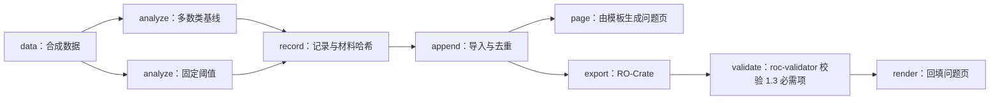

# Snakemake 执行、恢复与结果接入

依据现有本地 [Snakefile](../assets/demo/Snakefile)、[演示入口](../assets/demo/run_demo.py) 和 [运行契约](../references/contracts.md)。这是已接通的本地流程与真实项目接入协议，不是已部署的超算服务。

## 1. 工具分工

Snakemake 处理文件依赖、规则执行和目标产物；分析入口实现领域计算；配置固定科学方案；运行适配器写来源记录；公共记录程序导入、回填与导出。PLAN／TASK 管研究安排和验收，不把所有任务直接翻译成规则。

优先包装已有 Python／R／MATLAB 入口，不重写已经可靠的科学实现。单一步骤可直接执行；多步骤、有中间产物和重算边界时采用工作流。不同语言和宿主仍需实际验证，当前演示只验证 Python 本地执行。

## 2. 真实项目的接入顺序

1. 读取项目路径工具、入口和配置，列每阶段的输入、输出、参数、环境、资源和验收方法。
2. 将规则绑定明确产物。每项共享中间产品记录生产者与消费者；不要只因文件存在就假定其身份、单位或内容有效。
3. 科学参数与机器资源配置分开；展开有效配置并保存到独立 run。IO 路径通过项目路径工具解析为绝对位置。
4. 限定本次允许的方案和组合，先检查计算图与待执行目标；不默认全笛卡尔积、不把终评塞进默认目标。
5. 对代表性合成／脱敏输入做冒烟验证，再运行本次授权目标。记录命令、环境、退出码和实际产物。
6. 验收后生成 schema 兼容记录，导入 registry，回填 findings，再按验收更新 TASK；失败留证据与恢复点。

新增执行器、资源选项或环境管理接口前查本地 --help／所用版本文档，不凭记忆假定插件参数。首次接入保存实际版本与命令，不把演示规则直接套到真实科学数据。

## 3. 现有演示的计算图



实际 Snakefile 默认目标是 record.json；导入、导出、校验与回填由 run_demo.py 编排，不属于该 DAG 内的规则。上述图表示完整流程，不能误读为所有节点都已写成 Snakemake rule。

完整演示命令：

```text
<conda-python-absolute-path> <skill-absolute-path>/assets/demo/run_demo.py --output <new-absolute-output-directory>
```

本机用一个已装依赖的 Python 环境运行。输出目录必须不存在；演示写 snakemake.log、run1、registry.json、question.md、crate、validation.json 和 validator.log。question.md 是独立演示文件，真实项目回填到 plan/findings。

演示固定前 40 行训练、后 20 行测试，比对两条合成规则，仅验证管理链路；不是临床模型或完整嵌套验证。不将演示的公开许可复制到真实数据。

## 4. 恢复、复用与失败

恢复先检查原输入／配置／代码身份、日志与已有产物。相同身份且确为未完成的运行才考虑从原 run 恢复；科学方案改变则新 revision／run。已验收材料不得作为覆盖目标。

本地检查实际规则与 Snakemake 状态后恢复缺失阶段；不要为清除报错盲目解锁或删除输出。远端提交返回未知时先查调度器，不重新提交。回执应含机器、作业号、提交／核对时间、墙钟余量、当前阶段及下一核对动作。

无可用远端执行器时记录未支持，并继续可执行的本地检查。回传先暂存，核对文件身份与哈希后导入；重复一致不复制，重复冲突保留两侧。已结束、已回传、已验收、已备份分别报告。

## 5. 验收清单与能力边界

检查退出码、全部预期产物、输入／划分身份、有效配置、输出可读性、数值范围和类型特定科学检查；只有计算成功时不直接写科学检查 passed。核对是否有失败或缺失组合，不能只导入成功项。

现有演示覆盖基础执行与记录流程；多机调度、远端取消／重提、自动终评闸门、任意项目配置展开、跨语言环境锁和生产级失败注入未作为通用能力实现。按项目实测后再登记支持范围。

## 复跑而非只重启

按 [研究原则](research-principles.md) 检查环境恢复、手工准备步骤、目标产物和预定容差。原运行目录上无任务可执行只说明当前目标无需重算，不能代替独立环境复跑。接手检查用 [模板](../assets/templates/reproduction-check.md)，未执行的环境或硬件明确列为未验证。
