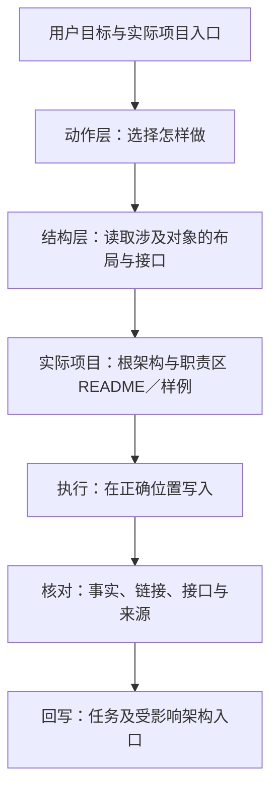
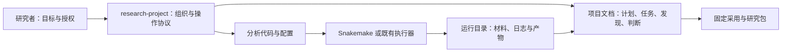
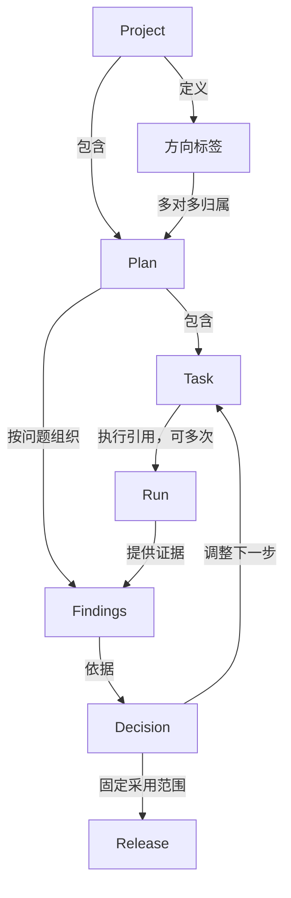

# 完整架构：动作层与结构层

本页是整体阅读入口。整体目录以 [项目结构层](../structures/project/GUIDE.md) 为准，字段和区内规则见相应结构模块，模块写入责任以 [协作契约](architecture-contract.md) 为准。本 skill 是一个入口、七个动作模块与六个结构模块；模块不是常驻 Agent。动作处理过程，结构规定对象布局与接口。

## 0. 两层如何配合

结构不是做完之后才调用的“整理工具”。例如 code 动作先读 code 结构及真实代码入口；run 动作组合 code/data/results；interpret 组合 documents/results；organize 才负责创建或跨区调整。

根 SKILL 提供两张路由表，每个动作 GUIDE 给出流程与结构依赖，每个结构 GUIDE 保存本区唯一规则，两类模块均有 EXAMPLE。实际项目采用这些规则后，整体入口与各区说明也要有真实架构和具体样例。完整示例见 [项目实例](../structures/project/EXAMPLE.md)。

## 1. 系统边界

借鉴 awesome-architecture 的分层视图：先说明边界，再说明对象与执行，不把目录树当成全部架构。本页借用分层表达方式，不声称 Markdown 目录就是 C4 的运行容器。

用户决定研究目标和授权范围；skill 按协议执行、记录和核对。文档描述安排和解释，计算引擎执行已确定工作，运行记录证明实际发生的事情。后台调度、真实超算、跨机器文件锁不是写进协议就自动具备。

## 2. 管理对象与关系

Project 管边界与资源；Plan 管目标、方案和整体验收；Task 管行动及验收；Run 固定一次执行；Findings 组织一个问题的证据；Decision 保存选择理由和范围；Release 固定实际采用。一个 run 可供多个计划引用，不能复制为多份独立事实。方向没有固定父子目录关系。

## 3. 四种存储职责

| 层 | 放什么 | 不承担什么 |
|---|---|---|
| 项目文档 docs/PROJECT 与 docs/plans | 目标、任务、发现、判断、采用及证据链接 | 不复制大型数据和模型 |
| 代码与配置根 | 活代码、方法策略、有效参数来源、环境声明 | 不用代码目录版本号代替方案或 run 身份 |
| 数据与运行根 | raw、interim、受控身份映射、results 中各 run | 不替代研究判断和当前任务状态 |
| 固定交付位置 | 已采用材料、来源、包校验和交付证明 | 不自动纳入所有探索产物 |

PROJECT 映射真实绝对位置和权限；同一仓可以管理多个项目，一个项目也可引用多个仓。归档不能破坏活动代码或采用材料的依赖。

## 4. 代码与执行结构

入口装配领域计算、方法策略和公共接口；路径／配置／来源记录保持共享实现。领域算法不依赖计划 Markdown 的目录名。每个跨语言或共享产品接口说明输入身份、列与单位、粒度、环境、输出和失败方式。

计划依赖与计算依赖分开：plan/task 的依赖表达“何种验收证据后才能做”，Snakemake 的 DAG 表达“哪些文件由哪些规则产生”。任务完成可能需要若干规则和人工判读；一个规则也可能生产多个计划共享的产品。不能用 Snakemake 的完成状态直接覆盖 TASK 的科学验收状态。

## 5. 全流程与回写

| 阶段 | 执行动作 | 必须落到哪里 |
|---|---|---|
| 接入 | 核对目标、现状、路径、已有证据和约束 | PROJECT、项目索引 |
| 规划 | 明确问题、方案、比较、预算、停止与完成标准 | PLAN、TASK，计划索引 |
| 准备 | 固定代码、输入、环境、有效配置与比较条件 | run 来源材料；findings 的设计区 |
| 执行 | 检查计算图，运行已授权目标，保存回执与失败 | run 日志；TASK 事件 |
| 验收 | 核对产物、身份、科学检查，保留所有尝试 | 运行记录、findings 事实区 |
| 判读 | 判断可比性、限制、发现和后续动作 | decisions；TASK／PLAN 更新 |
| 采用 | 固定选中图表及来源，复算、包校验、备份核对 | release 记录及交付包 |
| 接续 | 核对待判断、阻塞、在跑及下一动作 | 所属计划 TASK 接续区 |

有新缺陷时沿登记消费者追踪影响，标待复核；新方案产生修订，新执行产生 run，不回写旧结果。计划完成、假设成立、采用通过和实际交付各自核对。

## 6. 决策与架构演进

使用 [MADR 改写模板](../assets/templates/architecture-decision.md)：背景和范围 → 驱动因素 → 可行选项 → 决定与有利／不利／中性／未知后果 → 落实核对 → 迁移、恢复与重审。科学判断用 [科学决定模板](../assets/templates/scientific-decision.md)，补上比较条件与证据范围。

决定由主责计划保存；跨计划决定由 PROJECT 和相关计划引用同一份，不在项目根另建 decisions，也不复制到每个 task。接受决定不等于实施完成；Confirmation 核对实现符合决定，不代表假设成立。改变结论用新记录链接旧记录，保留原理由与证据。

## 7. 当前能力与待验证部分

已实现本地 run 记录校验／去重／冲突拒绝、标记区回填、基础 RO-Crate 导出、计划与任务引用／依赖检查，提供合成 Snakemake 演示。科学审查、终评准入、备份和脱敏目前依赖协议检查；没有自动项目群调度器、自动全量依赖扫描或远端作业对账器。具体操作见 [结果组织](results-workflow.md) 和 [执行流程](snakemake-workflow.md)。
